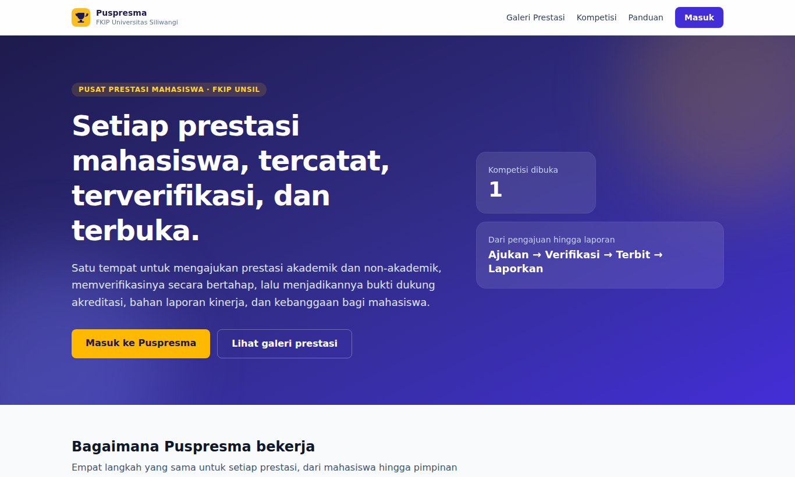
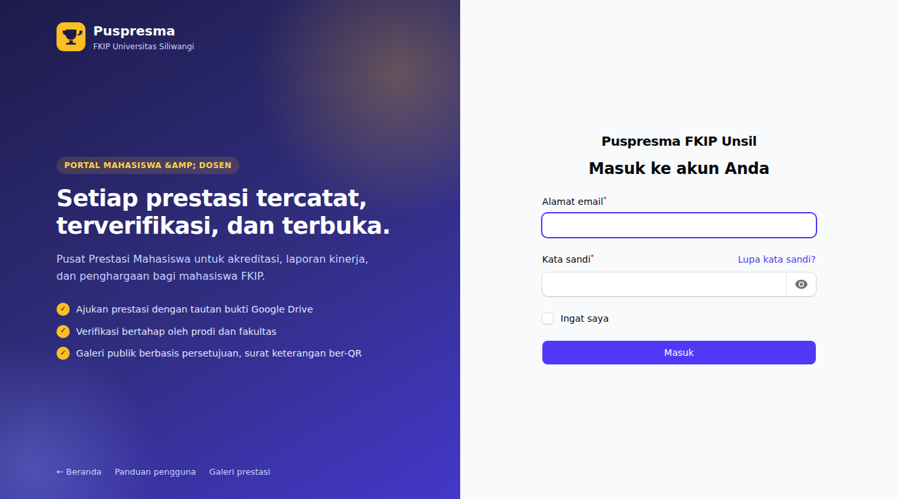

# Puspresma FKIP Unsil

[](https://github.com/satyasantika/puspresma/actions/workflows/ci.yml)

**Puspresma** (Pusat Prestasi Mahasiswa) Fakultas Keguruan dan Ilmu Pendidikan Universitas Siliwangi adalah aplikasi web
untuk mencatat, memverifikasi, dan melaporkan prestasi akademik dan non-akademik mahasiswa (kompetisi dan rekognisi;
tingkat lokal, wilayah, nasional, hingga internasional). Datanya menjadi bukti dukung akreditasi, bahan laporan
kinerja/IKU, berkas siap-lapor SIMKATMAWA, dan dasar seleksi beasiswa.



## Fitur utama

- **Pengajuan prestasi** oleh mahasiswa, termasuk tim lintas prodi: prestasi dicatat sekali, setiap anggota internal
  mendapat kredit, statistik prodi tetap akurat dan total fakultas dihitung unik.
- **Bukti berupa tautan** Google Drive (tanpa unggah berkas ke server). Tautan divalidasi (https, domain terdaftar,
  bukan folder atau pemendek), diperiksa keteraksesannya secara berkala, dan perubahannya dicatat.
- **Verifikasi bertahap** prodi lalu fakultas dengan catatan wajib untuk perbaikan/penolakan, riwayat status, deteksi
  kandidat duplikat, konfirmasi dosen pembimbing, dan penguncian setelah terverifikasi. Snapshot tautan disimpan saat
  terverifikasi.
- **Galeri publik berbasis persetujuan** (sesuai UU PDP): hanya prestasi terverifikasi yang disetujui pengaju; tanpa NPM
  dan tanpa tautan sertifikat; persetujuan dapat ditarik dan berlaku seketika.
- **Katalog kompetisi** dengan pengingat tenggat, **poin prestasi** opsional (bobot per jenis, tingkat, dan capaian), dan
  **surat keterangan prestasi ber-QR** yang keasliannya dapat diperiksa publik.
- **Dasbor, laporan, dan ekspor** Excel/PDF, termasuk berkas SIMKATMAWA; ekspor besar diproses lewat antrean.
- **Kelola pengguna**: impor massal dengan salin-tempel, profil dan ganti kata sandi, kewajiban ganti sandi per akun,
  keluar otomatis dari perangkat lain saat sandi diganti, dan masuk sebagai pengguna lain untuk keadaan darurat
  (tercatat di log aktivitas).
- **Keamanan dan audit**: otorisasi per record lewat Policy, log aktivitas, header keamanan (CSP, HSTS), pembatasan
  percobaan masuk, MFA aplikasi authenticator (opsional), dan backup basis data terenkripsi harian.



## Peran

| Peran | Panel | Ringkasan |
|---|---|---|
| Mahasiswa | Portal | Mengajukan prestasi, menautkan bukti, memantau status, mengatur persetujuan galeri, meminta surat keterangan |
| Dosen | Portal | Mengonfirmasi atau menyangkal bimbingan prestasi mahasiswa |
| Admin prodi | Admin | Verifikasi tahap prodi, peninjauan duplikat, laporan prodi |
| Admin fakultas | Admin | Verifikasi akhir, master data, kompetisi, galeri, surat, pengaturan, ekspor |
| Pimpinan | Admin | Dasbor dan laporan (akses baca) |
| Super admin | Admin | Pengguna dan peran, audit, antrean, backup (tidak memverifikasi prestasi: pemisahan tugas) |

Panduan bergambar per peran tersedia di `/panduan/index.html` dan dari landing page; panduan teks di menu **Bantuan**
(`docs/panduan/`).

## Teknologi

Laravel 13 · PHP 8.5 · MariaDB 10.11 · Redis 7 · Laravel Horizon · Filament 5 · Livewire 4 · Tailwind 4 · Pest 4 ·
Larastan (level 6) · Pint. Pustaka utama: spatie/laravel-permission, spatie/laravel-activitylog, spatie/laravel-backup,
spatie/simple-excel, dompdf, endroid/qr-code, Socialite (login Google kampus, opsional).

Konvensi: istilah domain berbahasa Indonesia, satu aksi bisnis satu kelas di `app/Actions`, perubahan status prestasi
hanya lewat `TransisiStatus`, kunci utama UUIDv7, dan pengaturan ambang dibaca lewat `Pengaturan::ambil`.

## Menjalankan di lingkungan lokal

Prasyarat: Docker (PHP 8.5 dan nginx), MariaDB 10.11, Redis, dan Node untuk membangun aset.

```bash
cp .env.example .env            # isi DB_PASSWORD dan REDIS_PASSWORD
composer install
php artisan key:generate
php artisan migrate --seed      # master data, peran, dan akun super admin awal
npm install && npm run build    # atau `npm run dev`
```

Akun super admin awal dibuat oleh seeder dari `SEED_SUPERADMIN_EMAIL` (bawaan `fkip@unsil.ac.id`) dan
`SEED_SUPERADMIN_PASSWORD`. **Ganti kata sandi awal segera setelah masuk** (menu Profil). Autentikasi dua langkah
dimatikan secara bawaan (`MFA_AKTIF=false`); nyalakan dengan `MFA_AKTIF=true` untuk mewajibkannya bagi super admin
dan admin fakultas.

Antrean (Horizon) dan penjadwal (`schedule:work`) berjalan sebagai proses terpisah. Setelah mengubah kode job, mulai
ulang Horizon. Jadwal harian meliputi pengarsipan kompetisi kedaluwarsa, pembersihan `storage/app/tmp`, pemeriksaan
tautan bukti, pengingat tenggat, dan backup.

Data prodi resmi: ganti `database/seeders/data/prodi.csv`, lalu `php artisan db:seed --class=ProdiSeeder`.

## Pengujian

```bash
./vendor/bin/pest --parallel                              # seluruh test (basis data db_puspresma_testing)
./vendor/bin/phpstan analyse --memory-limit=1G            # Larastan level 6
./vendor/bin/pint --test                                  # gaya kode
```

Pintasan: `composer test`, `composer stan`, `composer lint`, `composer cek`. Test memakai cache `array`, antrean `sync`,
dan sesi `array`, sehingga tidak menyentuh Redis. Hook commit di `.githooks` (`git config core.hooksPath .githooks`)
menjalankan gerbang yang sama sebelum commit.

## Deploy

Image produksi memakai `Dockerfile` (target `app` dan `web`) dan `docker-compose.prod.yml`. Rilis otomatis: push ke
`main` menjalankan CI (Pint, Larastan, Pest) lalu, bila hijau, `scripts/deploy.sh` di server (cadangan DB, build,
migrasi, health check, dan rollback). Rinciannya ada di [`docs/DEPLOY.md`](docs/DEPLOY.md); prosedur pemulihan di
[`docs/PEMULIHAN.md`](docs/PEMULIHAN.md); keputusan desain di [`docs/KEPUTUSAN.md`](docs/KEPUTUSAN.md).

### Subpath `https://<host>/<app>`

Aplikasi dapat dipasang di subfolder, misalnya `https://supportfkip.unsil.ac.id/puspresma`. Cukup atur `APP_URL` dan
`ASSET_URL` ke URL lengkap beserta subfolder, lalu bangun aset dengan nilai yang sama:

```bash
ASSET_URL=https://supportfkip.unsil.ac.id/puspresma npm run build
```

Path cookie sesi, awalan di nginx, dan pembuangan awalan di aplikasi diturunkan otomatis dari `APP_URL`. Reverse proxy
boleh memotong awalan (disarankan) atau meneruskannya apa adanya:

```nginx
location = /puspresma { return 301 /puspresma/; }
location /puspresma/ {
    proxy_pass http://127.0.0.1:8032/;          # garis miring akhir = awalan dipotong
    proxy_set_header Host $host;
    proxy_set_header X-Forwarded-Proto $scheme;
    proxy_set_header X-Forwarded-For $proxy_add_x_forwarded_for;
    proxy_set_header X-Forwarded-Prefix /puspresma;
    client_max_body_size 20m;
}
```

Isi `TRUSTED_PROXIES` dengan IP proxy (bukan `*`) di produksi. QR dan tautan tercetak memuat awalan: tetapkan awalan
final sebelum mencetak.

Setelah setiap deploy (dijalankan otomatis oleh entrypoint dan `scripts/deploy.sh`): `php artisan optimize`,
`filament:optimize`, dan `icons:cache`.

## Memperbarui panduan bergambar

Tangkapan layar dibuat otomatis dengan Playwright (hanya di lokal) dari akun demo `panduan.<peran>@contoh.test`:

```bash
php artisan migrate:fresh --seeder=PanduanSeeder          # akun demo + data rekaan; isi PANDUAN_PASSWORD di .env
PANDUAN_PASSWORD=... node tests/panduan/tangkap.mjs [peran]
node tests/panduan/bangun-html.mjs                        # menyusun public/panduan/*.html
```

Alur layar per peran ada di `tests/panduan/alur.json` dan teks peran di `tests/panduan/peran.json`. Panduan super admin
tidak dipublikasikan di halaman publik.

## Halaman galat

Seluruh galat HTTP umum (400–504) memakai halaman bertema di `resources/views/errors/`. Untuk pemeliharaan terencana:
`php artisan down --render="errors::503" --retry=60`.
