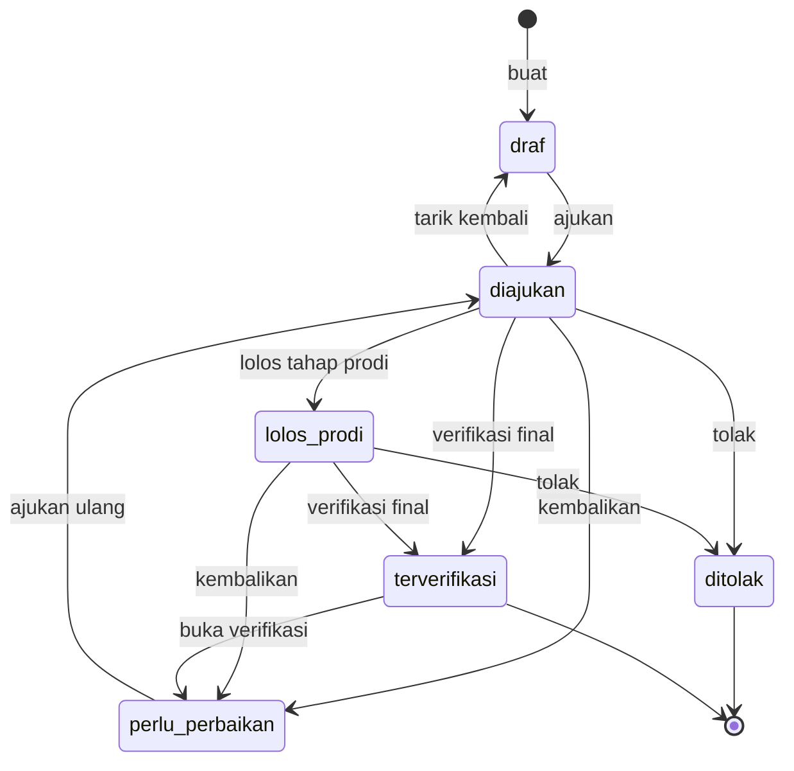
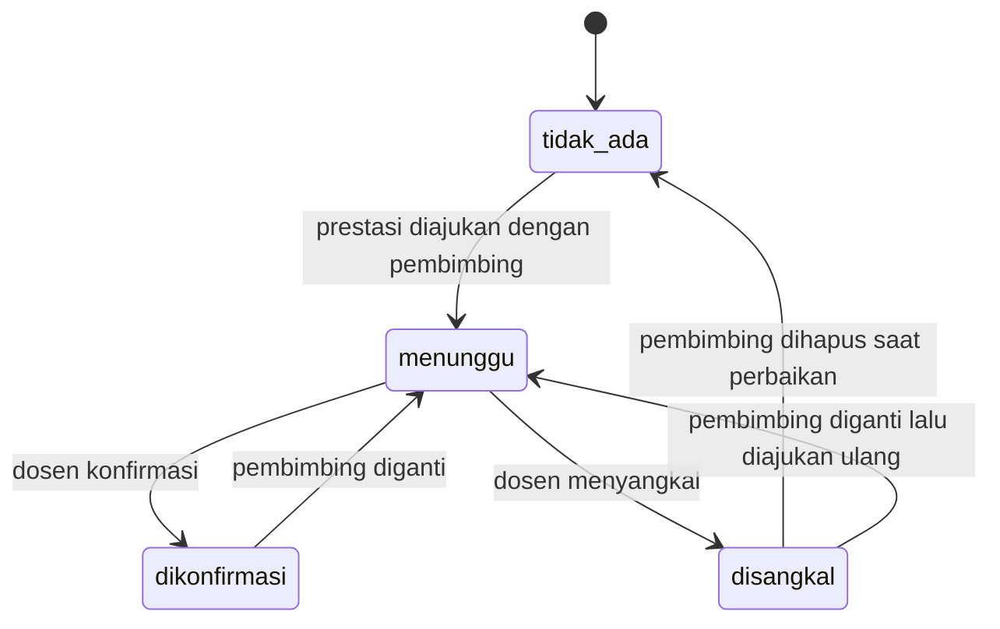

# 01 — Product Requirements Document (PRD)
# Puspresma: Pusat Prestasi Mahasiswa FKIP Universitas Siliwangi

| Atribut | Isi |
|---|---|
| Nama sistem | Puspresma FKIP Unsil (Pusat Prestasi Mahasiswa) |
| Pemilik produk | Wakil Dekan Bidang Kemahasiswaan FKIP (usulan, perlu ditetapkan) |
| Pengguna | Admin Fakultas, Admin Prodi, Mahasiswa, Dosen Pembimbing, Pimpinan, Super Admin (TI) |
| Stack | Laravel 13, MySQL 8.4, Redis 7, Filament 5, Livewire 4 (lihat `STANDAR-TEKNIS.md`) |
| Versi dokumen | 1.0 — 6 Oktober 2026 |

---

## 1. Latar belakang & masalah

Prestasi mahasiswa FKIP (juara lomba, kompetisi, penghargaan, rekognisi sebagai narasumber/juri, karya yang diakui) saat ini tercecer di grup pesan, surel, dan berkas Excel tiap prodi. Akibatnya:

1. **Bukti dukung akreditasi (LAMDIK) dan laporan kinerja** sulit dikumpulkan ulang setiap tahun; sertifikat hilang atau tidak terbaca.
2. **Data ganda**: satu lomba tim dicatat oleh beberapa anggota secara terpisah, atau dicatat dua kali oleh prodi berbeda, sehingga angka fakultas membengkak.
3. **Keabsahan tidak terjamin**: tidak ada alur verifikasi sertifikat dan tidak ada konfirmasi dari dosen pembimbing.
4. **Pelaporan ke SIMKATMAWA** (Sistem Informasi Manajemen Pemeringkatan Kemahasiswaan) dilakukan manual dan berulang.
5. **Statistik** per prodi/jenis/tingkat/tahun untuk pimpinan dan seleksi beasiswa berbasis prestasi tidak tersedia secara cepat.
6. **Informasi lomba** yang dapat diikuti mahasiswa tidak terpusat; tenggat sering terlewat.
7. **Publikasi prestasi** (galeri/website) dilakukan tanpa persetujuan eksplisit mahasiswa, padahal nama, foto, dan prodi adalah data pribadi.

Puspresma menyelesaikan masalah tersebut dengan satu basis data prestasi yang terverifikasi, bebas duplikat, dapat diekspor, dan dipublikasikan hanya atas persetujuan mahasiswa.

## 2. Dasar regulasi & acuan

> Prinsip: nomor pasal hanya ditulis bila dapat dipastikan. Selain itu ditandai **(perlu verifikasi)**. Tim pengembang tidak menafsirkan regulasi; penetapan akhir oleh pimpinan fakultas.

| No | Acuan | Status di folder sistem | Relevansi bagi Puspresma |
|---|---|---|---|
| R1 | **Permendikbudristek No. 46 Tahun 2023** tentang Pencegahan dan Penanganan Kekerasan di Lingkungan Satuan Pendidikan (PPKSP) | Ada | **Terbatas.** Regulasi ini mengatur pencegahan dan penanganan kekerasan, bukan pencatatan prestasi. Ruang lingkupnya diarahkan pada satuan pendidikan anak usia dini, dasar, dan menengah; untuk perguruan tinggi berlaku pengaturan tersendiri, yaitu Permendikbudristek No. 55 Tahun 2024 tentang PPKPT **(perlu verifikasi)**. Kaitan dengan Puspresma hanya pada **etika kegiatan kemahasiswaan**: kegiatan lomba/pembinaan yang melibatkan mahasiswa, dosen pembimbing, dan (untuk mahasiswa FKIP) siswa di sekolah harus bebas kekerasan. Puspresma **tidak** membangun kanal pelaporan kekerasan; cukup menampilkan tautan ke satgas/kanal resmi universitas di footer bila tersedia. |
| R2 | **UU No. 27 Tahun 2022** tentang Pelindungan Data Pribadi (UU PDP) | Disebut dalam brief | **Tinggi.** Galeri publik menampilkan nama, prodi, dan foto mahasiswa: wajib dasar pemrosesan berupa **persetujuan eksplisit** yang terekam dan dapat ditarik kembali. Pasal tentang dasar pemrosesan dan bentuk persetujuan (sekitar Pasal 20 dan 22) **(perlu verifikasi nomor pasal)**. Prinsip yang diterapkan: minimisasi data publik (tanpa NPM, tanpa sertifikat), hak menarik persetujuan, pencatatan persetujuan. |
| R3 | **Pedoman SIMKATMAWA / Pedoman Pemeringkatan Kemahasiswaan** (Puspresnas, Ditjen Belmawa; kini di bawah Kemendiktisaintek) | **Belum ada — disarankan ditambahkan** | **Tinggi.** Menentukan kategori kegiatan (kompetisi, rekognisi, dan kategori lain), tingkat, capaian, syarat bukti, dan kolom isian pelaporan. Puspresma merancang master data dengan kolom `kode_simkatmawa` dan ekspor yang dapat dipetakan. Format kolom, ambang jumlah negara/PT peserta, dan daftar kategori **(perlu verifikasi versi terbaru)**. |
| R4 | **Pedoman Pemilihan Mahasiswa Berprestasi (Pilmapres)** | Belum ada — disarankan | Sedang. Rekap prestasi per mahasiswa dan surat keterangan prestasi dipakai untuk seleksi tingkat fakultas **(perlu verifikasi versi terbaru)**. |
| R5 | **Indikator Kinerja Utama (IKU) PTN** terkait mahasiswa berprestasi. Pada Kepmendikbud No. 3/M/2021 prestasi mahasiswa termasuk dalam IKU 2; IKU telah/akan direvisi oleh Kemendiktisaintek | Belum ada — disarankan | Tinggi untuk laporan kinerja. Laporan Puspresma dibuat berbasis filter (tahun, tingkat minimal, capaian juara) agar dapat disesuaikan dengan definisi IKU yang berlaku **(perlu verifikasi definisi dan versi berlaku)**. |
| R6 | **SKPI (Surat Keterangan Pendamping Ijazah)** — diatur dalam peraturan menteri tentang ijazah (Permendikbud No. 81 Tahun 2014, kemudian Permendikbudristek No. 6 Tahun 2022) **(perlu verifikasi)** | Belum ada — disarankan | Sedang. Prestasi terverifikasi dapat diekspor per mahasiswa sebagai bahan SKPI. Puspresma **tidak** menerbitkan SKPI. |
| R7 | **Instrumen akreditasi LAMDIK** (kriteria mahasiswa/luaran) | Belum ada — disarankan | Tinggi. Laporan rekap prestasi per prodi per tahun (TS, TS-1, TS-2) sesuai tabel instrumen **(perlu verifikasi format tabel)**. |
| R8 | **SK Dekan / pedoman internal FKIP** tentang poin prestasi dan beasiswa berbasis prestasi | Belum ada — perlu dibuat fakultas | Tabel bobot poin di Puspresma bersifat konfigurable dan **contoh nilai bawaan bukan acuan resmi**. |

**Saran kepada pengguna:** tambahkan R3–R8 ke folder sistem sebelum fase F3 (master data) agar seeder kategori, tingkat, dan capaian dapat disesuaikan dengan pedoman resmi, dan sebelum F8 (ekspor SIMKATMAWA) agar urutan kolom ekspor dipastikan.

## 3. Peran & hak akses

### 3.1 Peran (nama peran = kebab-case di `spatie/laravel-permission`)

| Peran | Deskripsi | Panel |
|---|---|---|
| `super-admin` | TI fakultas: pengguna, peran, Horizon, pengaturan teknis | `/admin` |
| `admin-fakultas` | Bagian kemahasiswaan fakultas: verifikasi final, kelola semua data, katalog, ekspor, SIMKATMAWA | `/admin` |
| `admin-prodi` | Operator/koordinator kemahasiswaan prodi: lihat & rekap prestasi yang melibatkan mahasiswa prodinya; verifikasi tahap 1 bila diaktifkan | `/admin` |
| `pimpinan` | Dekan, Wakil Dekan, Koordinator Prodi: dasbor & laporan (baca saja) | `/admin` |
| `dosen` | Dosen pembimbing: konfirmasi bahwa ia membimbing; melihat prestasi bimbingannya | `/portal` |
| `mahasiswa` | Mengajukan prestasi + tautan bukti, mengelola persetujuan publikasi, melihat katalog lomba | `/portal` |

Satu pengguna boleh memiliki lebih dari satu peran (mis. dosen yang juga `admin-prodi`). `admin-prodi` dan `pimpinan` tingkat prodi dibatasi oleh `users.prodi_id`.

### 3.2 Matriks permission per modul

Kode: **L** lihat, **B** buat, **U** ubah, **H** hapus, **S** setujui/verifikasi, **E** ekspor. Tanda "milik" = hanya record miliknya; "prodi" = hanya record yang melibatkan prodinya.

| Modul (cakupan) | super-admin | admin-fakultas | admin-prodi | pimpinan | dosen | mahasiswa |
|---|---|---|---|---|---|---|
| `auth` pengguna & peran | L B U H | L (pengguna) | — | — | — | — |
| `master` prodi, kategori, tingkat, capaian | L B U H | L B U H | L | L | — | L (opsi form) |
| `master` mahasiswa & dosen (impor) | L B U H | L B U H E | L (prodi) E (prodi) | — | — | L (diri sendiri) |
| `prestasi` pengajuan | L | L B U (atas nama mahasiswa) | L (prodi) | L | L (bimbingan) | L B U H (milik, status draf/perlu_perbaikan) |
| `bukti` tautan bukti (`tautan_berkas`) | L | L B U H | L (prodi) | — | L (bimbingan) | L B U H (milik, saat draf/perlu_perbaikan) |
| `verifikasi` alur status | — | S (final), buka verifikasi | S (tahap 1, prodi pengaju) | — | — | ajukan, tarik kembali |
| `duplikat` kandidat duplikat | L | L S (tandai) | L (prodi) | — | — | — |
| `pembimbing` konfirmasi | — | L, ubah pembimbing | L (prodi) | — | S (milik) | L |
| `poin` bobot & rekap | L B U | L B U, hitung ulang, E | L (prodi) E (prodi) | L | — | L (milik) |
| `katalog` kompetisi | L B U H | L B U H | L B U (sasaran prodinya) | L | L | L, minat |
| `galeri` publikasi | L | L, sembunyikan/tampilkan | L | L | — | U (persetujuan milik) |
| `laporan` dasbor & ekspor | L E | L E | L E (prodi) | L E | — | E (rekap milik, PDF) |
| `simkatmawa` ekspor & penandaan | — | L E U (tandai dilaporkan) | L (prodi) | — | — | — |
| `surat` surat keterangan prestasi | L | L B, cabut | L (prodi) | L | — | L (milik) |
| `notifikasi` preferensi | L U | L U (milik) | L U (milik) | L U (milik) | L U (milik) | L U (milik) |
| `pengaturan` | L U | L U (domain) | — | — | — | — |
| `audit` log aktivitas | L | L | — | — | — | — |

### 3.3 Daftar permission (seeder `PeranDanIzinSeeder`)

`pengguna.kelola`, `master.kelola`, `mahasiswa.impor`, `dosen.impor`, `prestasi.lihat-semua`, `prestasi.lihat-prodi`, `prestasi.lihat-bimbingan`, `prestasi.buat-milik`, `prestasi.buat-atas-nama`, `prestasi.verifikasi-prodi`, `prestasi.verifikasi`, `prestasi.buka-verifikasi`, `duplikat.tinjau`, `pembimbing.konfirmasi`, `poin.kelola`, `poin.hitung-ulang`, `kompetisi.kelola`, `kompetisi.kelola-prodi`, `galeri.moderasi`, `laporan.lihat`, `laporan.ekspor`, `simkatmawa.ekspor`, `surat.terbitkan`, `pengaturan.kelola`, `audit.lihat`, `horizon.akses`.

Aturan per record (milik/prodi/bimbingan) **selalu** di Policy (`PrestasiPolicy`, `TautanBerkasPolicy`, dst.), bukan hanya di permission.

## 4. Daftar modul & kode cakupan commit

| Kode cakupan | Modul | Ringkasan |
|---|---|---|
| `auth` | Autentikasi & peran | Login lokal, Google (opsional, domain kampus), MFA admin, peran |
| `audit` | Jejak audit | `spatie/laravel-activitylog` |
| `master` | Data master | Prodi, mahasiswa, dosen, jenis kegiatan, kategori lomba, tingkat, capaian |
| `impor` | Impor Excel | Impor master mahasiswa & dosen via antrean |
| `prestasi` | Pengajuan prestasi | Formulir, anggota tim lintas prodi, anggota eksternal |
| `bukti` | Tautan bukti | Tautan sertifikat/piagam, foto penyerahan, surat tugas (tabel polimorfik `tautan_berkas`, tanpa unggah berkas ke server) |
| `verifikasi` | Alur verifikasi | Transisi status, riwayat, verifikasi tahap prodi |
| `duplikat` | Deteksi duplikat | Kandidat duplikat & peninjauan |
| `pembimbing` | Konfirmasi pembimbing | Permintaan & jawaban dosen |
| `poin` | Poin prestasi | Bobot tingkat × capaian, snapshot, rekap |
| `katalog` | Katalog kompetisi | Pengumuman lomba, tenggat, minat |
| `galeri` | Galeri publik | Persetujuan publikasi, foto publik, halaman publik |
| `notifikasi` | Notifikasi | Mail, database, WhatsApp |
| `jadwal` | Penjadwal | Scheduler & job berkala |
| `laporan` | Dasbor, laporan, ekspor | Statistik, Excel/PDF, akreditasi/IKU |
| `simkatmawa` | Ekspor SIMKATMAWA | Ekspor kolom terpetakan, penandaan dilaporkan |
| `surat` | Surat keterangan prestasi | PDF ber-QR + verifikasi publik |
| `pengaturan` | Pengaturan | Kunci-nilai konfigurable |
| `db`, `ui`, `api`, `deploy` | Teknis | Migrasi, tampilan, health endpoint, Docker |

## 5. User story & kriteria penerimaan

### 5.1 `auth`
- **US-AUTH-01** Sebagai mahasiswa, saya ingin masuk memakai akun `@student.unsil.ac.id` agar tidak perlu kata sandi baru.
  - Given Google login aktif dan email saya ada di master `mahasiswa`, When saya klik "Masuk dengan Google", Then saya masuk ke `/portal` dengan peran `mahasiswa`.
  - Given email `@gmail.com`, When login Google, Then ditolak dengan pesan "Gunakan akun kampus".
- **US-AUTH-02** Sebagai admin fakultas, saya ingin wajib MFA agar akun verifikator tidak mudah diambil alih.
  - Given peran `admin-fakultas` tanpa MFA, When login, Then diarahkan ke pengaturan MFA sebelum dapat membuka menu lain.
- **US-AUTH-03** Sebagai super admin, saya ingin membuat akun lokal untuk dosen luar/operator agar tetap dapat bekerja bila Google tidak tersedia.

### 5.2 `master` & `impor`
- **US-MST-01** Sebagai admin fakultas, saya ingin mengimpor data mahasiswa (NPM, nama, prodi, angkatan, email) dari Excel agar anggota tim dapat dipilih dari daftar.
  - Given berkas `.xlsx` sesuai templat, When impor dijalankan, Then data di-*upsert* berdasarkan NPM di antrean dan saya menerima ringkasan berhasil/gagal beserta berkas baris galat.
  - Given kode prodi tidak dikenal, Then baris itu gagal dengan alasan "kode prodi tidak ditemukan", baris lain tetap diproses.
- **US-MST-02** Sebagai admin fakultas, saya ingin mengelola kategori, tingkat, dan capaian beserta `kode_simkatmawa` agar ekspor dapat dipetakan tanpa mengubah kode program.
- **US-MST-03** Sebagai admin prodi, saya ingin melihat daftar mahasiswa prodi saya saja.
  - Given admin prodi Pendidikan Matematika, When membuka menu Mahasiswa, Then hanya mahasiswa prodi tersebut yang tampil; akses URL record prodi lain mengembalikan 403.

### 5.3 `prestasi` & `bukti`
- **US-PRS-01** Sebagai mahasiswa, saya ingin mengisi formulir prestasi (nama kegiatan, penyelenggara, jenis kegiatan, bidang, kategori, tingkat, capaian, individu/kelompok, tanggal, moda & lokasi, jumlah peserta, URL kegiatan, dosen pembimbing) agar prestasi saya tercatat resmi.
  - Given tingkat "internasional", When saya menyimpan, Then kolom jumlah negara peserta dan daftar negara wajib diisi.
  - Given bentuk "kelompok", Then minimal 2 anggota (FKIP + eksternal) harus tercatat.
- **US-PRS-02** Sebagai mahasiswa ketua tim, saya ingin menambahkan anggota dari prodi lain di FKIP agar semua anggota mendapat kredit.
  - Given anggota dari Pendidikan Biologi, When prestasi terverifikasi, Then prestasi terhitung pada statistik Pendidikan Biologi dan prodi pengaju.
- **US-PRS-03** Sebagai mahasiswa, saya ingin menambahkan anggota dari luar FKIP (nama, institusi) agar data tim lengkap, walaupun mereka tidak dihitung dalam statistik FKIP.
- **US-PRS-04** Sebagai mahasiswa, saya ingin mencantumkan **tautan** Google Drive (atau penyedia lain yang diizinkan) untuk sertifikat/piagam, foto penyerahan, dan surat tugas agar dapat diverifikasi tanpa mengirim berkas ke server.
  - Given tautan `http://`, pemendek (`bit.ly`, `s.id`), domain di luar daftar putih, atau tautan folder Drive, Then ditolak dengan pesan jelas (rule `TautanBerkasValid`).
  - Given tautan Drive valid, Then `drive_file_id` diekstrak, tautan tersimpan, dan job `PeriksaTautanBerkas` memeriksa keteraksesan; hasil "tidak dapat diakses" hanya menjadi peringatan, tidak memblokir simpan.
  - Given tautan dengan `drive_file_id` yang sama sudah dipakai di prestasi lain, Then pengajuan tetap dapat dikirim tetapi ditandai kandidat duplikat.
  - Formulir menampilkan petunjuk berbagi: sertifikat/piagam & foto boleh "Siapa saja yang memiliki link"; dokumen yang memuat data pribadi (mis. surat tugas ber-NIP/NPM, dokumen ber-NIK) dibagikan terbatas ke akun/organisasi kampus.
- **US-PRS-05** Sebagai mahasiswa, saya ingin memilih kompetisi dari katalog saat mengisi formulir agar nama kegiatan dan penyelenggara terisi otomatis.
- **US-PRS-06** Sebagai admin fakultas, saya ingin menginput prestasi atas nama mahasiswa (data lama/arsip) agar riwayat prestasi sebelum sistem ada ikut tercatat.

### 5.4 `verifikasi`, `duplikat`, `pembimbing`
- **US-VRF-01** Sebagai admin fakultas, saya ingin antrean prestasi berstatus `diajukan`/`lolos_prodi` dengan pratinjau sematan Drive (`/file/d/<id>/preview`) dan tombol "Buka berkas" di samping data agar verifikasi cepat.
  - Given saya menekan Verifikasi, Then saya wajib mencentang "Saya telah membuka dan memeriksa semua tautan bukti"; sistem mencatat tautan mana yang sudah saya buka.
  - Given prestasi menjadi `terverifikasi`, Then sistem menyimpan snapshot URL seluruh tautan bukti (BR-28).
- **US-VRF-02** Sebagai admin fakultas, saya ingin mengembalikan pengajuan dengan status `perlu_perbaikan` beserta catatan agar mahasiswa tahu apa yang harus diperbaiki.
  - Given catatan kosong, Then aksi ditolak (BR-08).
- **US-VRF-03** Sebagai admin prodi, saya ingin memverifikasi tahap 1 bila fitur diaktifkan agar beban fakultas berkurang.
  - Given `verifikasi_prodi_aktif = false`, Then aksi "Lolos tahap prodi" tidak tampil.
- **US-VRF-04** Sebagai admin fakultas, saya ingin melihat kandidat duplikat dan menandai "bukan duplikat" atau "duplikat" agar data tidak ganda.
  - Given ada kandidat `belum_ditinjau`, When saya klik Verifikasi, Then ditolak dengan pesan "Tinjau kandidat duplikat terlebih dahulu" (BR-10).
- **US-VRF-05** Sebagai dosen, saya ingin mengonfirmasi atau menyangkal bahwa saya membimbing suatu prestasi agar data pembimbingan sah.
  - Given saya menyangkal, Then alasan wajib diisi dan admin mendapat notifikasi.
- **US-VRF-06** Sebagai admin fakultas, saya ingin membuka kembali verifikasi (mis. ada kekeliruan tingkat) dengan alasan agar koreksi tetap tercatat.

### 5.5 `poin`
- **US-POIN-01** Sebagai admin fakultas, saya ingin mengatur bobot poin per jenis kegiatan × tingkat × capaian dengan tanggal berlaku agar pemeringkatan internal dan seleksi beasiswa konsisten.
- **US-POIN-02** Sebagai mahasiswa, saya ingin melihat total poin terverifikasi saya per periode.
- **US-POIN-03** Sebagai admin fakultas, saya ingin peringkat mahasiswa berdasarkan poin per periode dan prodi, dapat diekspor, untuk seleksi beasiswa.

### 5.6 `katalog`
- **US-KAT-01** Sebagai admin fakultas/prodi, saya ingin mengumumkan kompetisi (judul, penyelenggara, tingkat, kategori, tenggat pendaftaran, tautan pendaftaran, tautan poster, sasaran prodi) agar mahasiswa tidak tertinggal informasi.
- **US-KAT-02** Sebagai mahasiswa, saya ingin menandai "berminat" pada kompetisi agar mendapat pengingat H-3 sebelum tenggat.
- **US-KAT-03** Sebagai pengunjung publik, saya ingin melihat daftar kompetisi yang masih dibuka di `/kompetisi`.

### 5.7 `galeri`
- **US-GAL-01** Sebagai mahasiswa, saya ingin memberikan atau menarik persetujuan publikasi per prestasi agar data saya hanya tampil bila saya izinkan.
  - Given saya menarik persetujuan, When halaman galeri dimuat ulang, Then nama saya tidak tampil (cache dibersihkan seketika).
- **US-GAL-02** Sebagai pengunjung, saya ingin melihat galeri prestasi terverifikasi dengan filter tahun, tingkat, prodi.
- **US-GAL-03** Sebagai admin fakultas, saya ingin menyembunyikan satu prestasi dari galeri dengan alasan (moderasi) tanpa mengubah status verifikasinya.

### 5.8 `notifikasi` & `jadwal`
- **US-NTF-01** Sebagai mahasiswa, saya ingin notifikasi surel/database (dan WhatsApp bila saya aktifkan) saat status berubah.
- **US-NTF-02** Sebagai admin fakultas, saya ingin ringkasan harian antrean verifikasi.
- **US-NTF-03** Sebagai dosen, saya ingin pengingat bila ada permintaan konfirmasi pembimbing yang belum dijawab lebih dari 7 hari.

### 5.9 `laporan`, `simkatmawa`, `surat`
- **US-LAP-01** Sebagai pimpinan, saya ingin dasbor jumlah prestasi per prodi, jenis, tingkat, capaian, dan tahun.
- **US-LAP-02** Sebagai admin fakultas/prodi, saya ingin mengekspor rekap ke Excel/PDF dengan filter agar dapat dilampirkan pada dokumen akreditasi.
- **US-LAP-03** Sebagai admin fakultas, saya ingin ekspor dengan kolom yang dapat dipetakan ke format isian SIMKATMAWA (termasuk kolom URL bukti dari snapshot) dan menandai prestasi yang sudah dilaporkan.
- **US-LAP-04** Sebagai admin fakultas, saya ingin menerbitkan Surat Keterangan Prestasi ber-QR untuk mahasiswa (beasiswa/SKPI/Pilmapres) yang keasliannya dapat dicek publik.
- **US-LAP-05** Sebagai mahasiswa, saya ingin mengunduh rekap prestasi terverifikasi saya (PDF) untuk portofolio.

## 6. Aturan bisnis

| Kode | Aturan |
|---|---|
| **BR-01** | Satu record `prestasi` = satu kegiatan + satu capaian. Prestasi tim dicatat **sekali** dengan banyak anggota, bukan satu record per anggota. |
| **BR-02** | Semua anggota tim yang terdaftar di `mahasiswa` mendapat kredit penuh. Statistik per prodi menghitung prestasi pada **setiap** prodi anggota; total fakultas menghitung prestasi **unik**. Anggota eksternal dicatat tetapi tidak dihitung. |
| **BR-03** | Pengaju otomatis menjadi anggota (`is_pengaju = true`). Hanya pengaju dan `admin-fakultas` yang dapat mengubah data prestasi, dan hanya saat status `draf` atau `perlu_perbaikan`. |
| **BR-04** | Syarat **ajukan**: kolom wajib lengkap; `tanggal_mulai ≤ tanggal_selesai ≤ hari ini`; minimal 1 tautan jenis `sertifikat_piagam`; bentuk `kelompok` minimal 2 anggota (internal + eksternal); bentuk `individu` tepat 1 anggota internal dan 0 eksternal; capaian harus sesuai jenis kegiatan. |
| **BR-05** | Tingkat `internasional` wajib `jumlah_negara_peserta` dan `negara_peserta`; bila jumlah negara < `ambang_negara_internasional` (bawaan 3, **perlu verifikasi** terhadap pedoman SIMKATMAWA) sistem menampilkan peringatan kepada verifikator (tidak memblokir). Tingkat `nasional` wajib `jumlah_pt_peserta`; ambang `ambang_pt_nasional` dapat diatur (bawaan kosong, **perlu verifikasi**). |
| **BR-06** | **Tidak ada unggah berkas ke server** (STANDAR-TEKNIS §1a). Bukti berupa tautan di tabel polimorfik `tautan_berkas` (pemilik `Prestasi`; jenis `sertifikat_piagam`, `foto_penyerahan`, `surat_tugas`, `lainnya`). Validasi `TautanBerkasValid`: hanya `https://`, domain daftar putih `config/berkas.php`, tolak pemendek URL dan tautan folder; `drive_file_id` diekstrak. Job `PeriksaTautanBerkas` memeriksa keteraksesan (informatif, tidak memblokir). Maksimal 10 tautan per prestasi. Tautan hanya ditampilkan kepada peran yang berhak menurut Policy; perubahan tautan dicatat activitylog (URL lama → baru). |
| **BR-07** | Perubahan status hanya melalui kelas Action di `app/Actions/Prestasi`. Transisi sah: `draf→diajukan`, `diajukan→draf` (tarik kembali, oleh pengaju), `diajukan→lolos_prodi`, `diajukan|lolos_prodi→perlu_perbaikan|terverifikasi|ditolak`, `perlu_perbaikan→diajukan`, `terverifikasi→perlu_perbaikan` (buka verifikasi). Transisi lain ditolak dengan exception `TransisiTidakSah`. Setiap transisi menulis `riwayat_status_prestasi` dan activitylog. |
| **BR-08** | Transisi ke `perlu_perbaikan`, `ditolak`, dan buka verifikasi wajib catatan minimal 10 karakter. |
| **BR-09** | Bila `verifikasi_prodi_aktif = true`: `admin-prodi` dari **prodi pengaju** dapat memindahkan `diajukan→lolos_prodi`, `perlu_perbaikan`, atau `ditolak`. `admin-fakultas` memverifikasi dari `lolos_prodi`; bila ingin langsung dari `diajukan` wajib mencentang "ambil alih" dengan catatan. Bila `false`, status `lolos_prodi` tidak dipakai. |
| **BR-10** | Saat `diajukan`, job `DeteksiDuplikatPrestasi` mencari kandidat: (a) ada anggota mahasiswa yang sama **dan** kemiripan `nama_kegiatan_normal` ≥ `ambang_kemiripan_duplikat` (bawaan 0,80) **dan** selisih `tanggal_mulai` ≤ `rentang_hari_duplikat` (bawaan 7 hari); atau (b) ada tautan bukti dengan `drive_file_id` sama (atau URL ternormalisasi sama untuk penyedia non-Drive) di prestasi lain. Kandidat disimpan di `kandidat_duplikat`. Prestasi **tidak dapat** diverifikasi selama ada kandidat `belum_ditinjau`. |
| **BR-11** | Bila `dosen_pembimbing_id` diisi, saat diajukan status konfirmasi menjadi `menunggu` dan dosen diberi permintaan. Dosen dapat `dikonfirmasi` atau `disangkal` (alasan wajib). Verifikasi saat `menunggu` hanya dengan centang "verifikasi tanpa konfirmasi pembimbing" + catatan. Saat `disangkal`, verifikasi diblokir sampai pembimbing diubah/dihapus melalui `perlu_perbaikan`. |
| **BR-12** | Prestasi `terverifikasi` terkunci (semua kolom & tautan bukti read-only). Koreksi hanya lewat "buka verifikasi" oleh `admin-fakultas` (→ `perlu_perbaikan`), yang juga menghapus snapshot poin. |
| **BR-13** | `ditolak` adalah status akhir; record tidak dapat diubah. Mahasiswa boleh membuat pengajuan baru. |
| **BR-14** | Hapus (soft delete) hanya untuk prestasi `draf` oleh pengaju atau admin fakultas. Tautan bukti dapat ditambah/diubah/dihapus hanya saat `draf`/`perlu_perbaikan`. |
| **BR-15** | Cakupan `admin-prodi`: melihat prestasi yang memiliki minimal satu anggota dari prodinya (`prestasi_anggota → mahasiswa.prodi_id`). Verifikasi tahap 1 hanya untuk prestasi dengan `prestasi.prodi_id` (prodi pengaju) = prodinya. |
| **BR-16** | Galeri publik menampilkan prestasi bila: status `terverifikasi`, `galeri_aktif = true`, pengaju `setuju_publikasi = true`, dan `disembunyikan_dari_galeri = false`. Nama anggota tampil hanya bagi yang setuju; lainnya ditulis "dan N anggota lain". NPM, tautan sertifikat, dan tautan surat tugas **tidak pernah** publik. Foto hanya dari tautan `foto_penyerahan` yang memenuhi semua syarat: mahasiswa menandai `tampil_publik = true`, penyedia `google_drive` dengan `drive_file_id`, dan `status_cek = dapat_diakses` (artinya dibagikan publik); ditampilkan via `https://lh3.googleusercontent.com/d/<drive_file_id>` dengan placeholder bila gagal dimuat. Sistem tidak dapat membuang metadata EXIF/lokasi dari berkas di Drive, sehingga formulir mengingatkan mahasiswa memakai foto tanpa data lokasi. |
| **BR-17** | Persetujuan publikasi bersifat opt-in (bawaan `false`), terekam waktunya (`setuju_publikasi_at`) dan di activitylog, dapat ditarik kapan saja; penarikan langsung menghapus cache galeri terkait. |
| **BR-18** | Poin dihitung hanya bila `poin_aktif = true`: poin = `bobot_poin` (jenis kegiatan, tingkat, capaian) yang berlaku pada `tanggal_selesai`. Mode tim `mode_poin_tim`: `penuh` (bawaan, setiap anggota mendapat poin penuh) atau `dibagi` (poin ÷ jumlah anggota internal, dibulatkan 2 desimal). Poin disimpan sebagai snapshot di `prestasi_anggota.poin` saat terverifikasi; perubahan bobot tidak mengubah snapshot kecuali admin menjalankan "hitung ulang" (tercatat di audit). Nilai poin `DECIMAL`, bukan float. |
| **BR-19** | Impor mahasiswa: kunci `npm`; *upsert* `nama`, `prodi_id` (dari `kode` prodi), `angkatan`, `email`, `status_mahasiswa`; tidak pernah menghapus; email harus berdomain `student.unsil.ac.id` bila diisi; berkas galat dibuat untuk baris gagal. Berkas Excel impor diproses dari `storage/app/tmp` lalu dihapus (bukan disimpan); berkas galat sementara terhapus ≤ 24 jam. Hanya satu impor berjalan per jenis (Redis lock). |
| **BR-20** | Login Google hanya untuk email berdomain `student.unsil.ac.id` (mahasiswa) atau `unsil.ac.id` (dosen/staf), diperiksa di server (bukan hanya parameter `hd`). Akun harus sudah ada di master: dicocokkan dengan `mahasiswa.email`/`dosen.email`, lalu (mahasiswa) dengan bagian lokal email = NPM **(pola email mahasiswa perlu verifikasi ke UPT TIK)**. Tidak ada registrasi mandiri. |
| **BR-21** | Tahun statistik = tahun `tanggal_selesai`. Tahun akademik dihitung dengan `awal_tahun_akademik_bulan` (bawaan 8/Agustus, **perlu verifikasi kalender akademik Unsil**). |
| **BR-22** | Peringatan (tidak memblokir) bila tahun kegiatan < angkatan salah satu anggota, atau `tanggal_selesai` lebih lama dari `batas_klaim_bulan` (bawaan 24) sebelum tanggal ajukan. |
| **BR-23** | Katalog: kompetisi `terbit` hanya bila `tenggat_pendaftaran ≥ sekarang`; otomatis `diarsipkan` setelah tenggat lewat (scheduler). `admin-prodi` hanya dapat mengelola kompetisi yang sasaran prodinya hanya prodinya sendiri. Deskripsi rich text disanitasi. |
| **BR-24** | Surat Keterangan Prestasi hanya memuat prestasi `terverifikasi`; nomor diterbitkan di bawah Redis lock + transaksi; PDF dan QR dibangkitkan *on-the-fly* dan di-stream (tidak disimpan); QR berisi URL `/verifikasi/{id}`; halaman verifikasi publik hanya menampilkan nomor, nama mahasiswa, prodi, tanggal terbit, status (aktif/dicabut), dan daftar judul prestasi. |
| **BR-25** | Ekspor kecil (≤ 2.000 baris) di-stream langsung ke browser; ekspor besar berjalan di antrean `ekspor`, hasilnya disimpan sementara di `storage/app/tmp` dan dihapus otomatis ≤ 24 jam. `admin-prodi` hanya data prodinya; unduhan hanya oleh pemohon; setiap ekspor tercatat di activitylog. |
| **BR-26** | Data pribadi (email, nomor HP/WA mahasiswa) hanya terlihat oleh `admin-fakultas`, `super-admin`, dan pemiliknya. `pimpinan` melihat agregat dan daftar (nama, prodi, kegiatan) tanpa kontak. |
| **BR-27** | Penandaan SIMKATMAWA (`dilaporkan_simkatmawa_at`) hanya untuk prestasi `terverifikasi`, oleh `admin-fakultas`, dapat dibatalkan dengan catatan. |
| **BR-28** | Saat status menjadi `terverifikasi`, sistem menyimpan **snapshot** setiap tautan bukti aktif ke `snapshot_tautan_verifikasi` (URL, `drive_file_id`, jenis, `status_cek`, waktu, verifikator). Snapshot tidak dapat diubah dan menjadi rujukan ekspor SIMKATMAWA, laporan akreditasi, dan audit, karena isi berkas di Drive dapat berubah di luar sistem. Buka verifikasi tidak menghapus snapshot lama; verifikasi berikutnya menambah snapshot baru. |
| **BR-29** | Verifikator wajib membuka tautan bukti sebelum verifikasi: tombol "Buka berkas" melewati route `tautan.buka` yang mencatat activitylog (siapa, kapan, tautan mana) lalu mengalihkan ke URL; aksi Verifikasi mensyaratkan centang konfirmasi dan menampilkan peringatan bila ada tautan `sertifikat_piagam` yang belum pernah dibuka verifikator tersebut. |
| **BR-30** | `PeriksaTautanBerkas` berjalan saat tautan disimpan dan ulang mingguan. Tautan yang berubah menjadi `tidak_dapat_diakses` memicu notifikasi ke pemilik (pengaju) dan, bila prestasi sudah terverifikasi, tanda "tautan bukti bermasalah" di panel admin. Penggantian tautan pada prestasi terverifikasi hanya oleh `admin-fakultas` (aksi "Ganti tautan", catatan wajib, URL lama → baru di activitylog, snapshot baru ditambahkan); mahasiswa meminta lewat admin. |
| **BR-31** | Petunjuk privasi berbagi (UU PDP): sertifikat/piagam dan foto penyerahan boleh dibagikan "Siapa saja yang memiliki link"; dokumen yang memuat data pribadi sensitif (NIK, NIP, nilai, alamat) wajib dibagikan terbatas ke akun/organisasi kampus atau akun verifikator. Kemampuan akun `@student.unsil.ac.id` berbagi ke domain `unsil.ac.id` bergantung konfigurasi Google Workspace kampus **(perlu verifikasi ke UPT TIK)**. |

### 6.1 Diagram alur status prestasi

### 6.2 Diagram konfirmasi dosen pembimbing

## 7. Kebutuhan non-fungsional

| Aspek | Kebutuhan |
|---|---|
| Keamanan | Policy per record di setiap Resource; UUID untuk URL publik & unduhan; MFA wajib `super-admin` & `admin-fakultas`; rate limit login, formulir, galeri, verifikasi QR; validasi tautan (`TautanBerkasValid`: https, daftar putih domain, tanpa pemendek); tidak ada unggah berkas selain impor Excel sementara; sanitasi rich text; CSRF bawaan; HTTPS, cookie `secure`. |
| Privasi (UU PDP) | Persetujuan publikasi opt-in & dapat ditarik; minimisasi data publik; foto galeri hanya dari tautan yang sengaja dibagikan publik dan disetujui; petunjuk berbagi terbatas untuk dokumen ber-data pribadi (BR-31); log aktivitas tanpa kata sandi/token; kontak hanya untuk peran berwenang. |
| Kinerja | Halaman galeri & dasbor < 1 detik dari cache Redis; daftar admin 25 baris/halaman < 500 ms dengan 50.000 prestasi; impor 10.000 baris mahasiswa < 2 menit di antrean. |
| Audit | Semua perubahan pada `prestasi`, `prestasi_anggota`, `tautan_berkas` (URL lama → baru), `bobot_poin`, `pengaturan`, `kompetisi`, `surat_keterangan_prestasi` tercatat di activitylog; riwayat status di tabel terpisah. |
| Ketersediaan & cadangan | Backup harian MySQL (retensi ≥ 30 hari); uji pulih tiap semester. Berkas bukti berada di Google Drive mahasiswa; snapshot URL (BR-28) menjaga jejak, dan pemeriksaan mingguan (BR-30) mendeteksi tautan mati. Disarankan fakultas menyediakan Shared Drive untuk arsip bukti prestasi tingkat nasional/internasional. |
| Aksesibilitas | Kontras WCAG AA, label form, navigasi papan ketik, teks alternatif foto galeri. |
| Responsif ponsel | Formulir pengajuan & isian tautan bukti nyaman di ponsel (mayoritas mahasiswa); tautan dapat ditempel dari aplikasi Google Drive ponsel ("Salin link"). |
| Bahasa | Antarmuka Bahasa Indonesia; tanggal format `d F Y`. |
| Keterlacakan | Nomor registrasi prestasi `PRS-YYYY-NNNNN` unik. |
| Kesiapan penyimpanan | Semua akses berkas lewat `App\Contracts\PenyimpananBerkas` (implementasi aktif `TautanEksternal`, `BERKAS_MODE=tautan`) agar kelak dapat beralih ke disk/S3 tanpa mengubah modul. |

## 8. Laporan & ekspor

| Kode | Laporan | Format | Filter | Pemakai |
|---|---|---|---|---|
| LAP-01 | Rekap prestasi (daftar lengkap, satu baris per prestasi) | XLSX, PDF | tahun/rentang tanggal, prodi, jenis, bidang, tingkat, capaian, status | Admin, pimpinan |
| LAP-02 | Rekap per anggota (satu baris per prestasi × mahasiswa) | XLSX | sama | Admin |
| LAP-03 | Statistik prodi × tingkat × tahun (TS, TS-1, TS-2) untuk akreditasi LAMDIK **(format tabel perlu verifikasi)** | XLSX, PDF | prodi, tahun akhir | Admin prodi, pimpinan |
| LAP-04 | Rekap IKU: jumlah mahasiswa unik berprestasi dengan tingkat minimal & capaian juara (parameter dapat diatur) **(definisi perlu verifikasi)** | XLSX, PDF | tahun, tingkat minimal, hanya juara | Pimpinan |
| LAP-05 | Ekspor SIMKATMAWA (kolom terpetakan, satu baris per prestasi × mahasiswa, termasuk URL bukti dari snapshot verifikasi) | XLSX/CSV | belum dilaporkan, tahun, jenis | Admin fakultas |
| LAP-06 | Peringkat poin mahasiswa per periode | XLSX, PDF | periode, prodi, angkatan | Admin, panitia beasiswa |
| LAP-07 | Rekap prestasi pribadi mahasiswa (bahan SKPI/portofolio) | PDF | — | Mahasiswa |
| LAP-08 | Surat Keterangan Prestasi ber-QR | PDF | mahasiswa, periode | Admin fakultas |
| LAP-09 | Rekap katalog: jumlah kompetisi diumumkan, minat, dan prestasi yang terkait kompetisi katalog | XLSX | tahun | Admin fakultas |

## 9. Di luar cakupan & keterkaitan dengan sistem lain

**Di luar cakupan (v1.0):**
- Penerbitan SKPI, pengelolaan beasiswa (pendaftaran/penetapan penerima), pendanaan lomba/pencairan dana — Puspresma hanya menyediakan data.
- Pengiriman otomatis ke SIMKATMAWA via API (tidak ada API resmi yang diketahui, **perlu verifikasi**); admin mengisi SIMKATMAWA secara manual berbekal ekspor. Bila SIMKATMAWA mensyaratkan berkas (bukan tautan), admin mengambilnya dari Drive mahasiswa **(perlu verifikasi)**.
- Penyimpanan berkas di server (ditunda sampai kapasitas storage tersedia; lihat STANDAR-TEKNIS §1a).
- Penilaian Pilmapres (hanya rekap & surat keterangan).
- Kanal pelaporan kekerasan (ranah satgas/TPPK universitas).
- Aplikasi seluler native.

**Keterkaitan dengan sistem FKIP lain (tidak dibangun integrasinya sekarang):**
- **FKIP Edu (portal & SSO)** — kelak login OIDC menggantikan/menambah login lokal & Google; tabel `users` sudah memuat `email`, `npm`, `nidn`, `prodi_id`.
- **Akreditasi** — mengonsumsi LAP-03 sebagai bukti dukung.
- **SDM** — sumber data dosen (kolom `kode_eksternal`).
- **Surat** — bila kelak surat tugas lomba diterbitkan di sistem Surat, Puspresma cukup menyimpan nomor/tautannya.
- **Keuangan** — bantuan dana lomba/penghargaan tunai di luar cakupan.
- **OrmawaHub** — memakai gateway WhatsApp yang sama (Fonnte).
