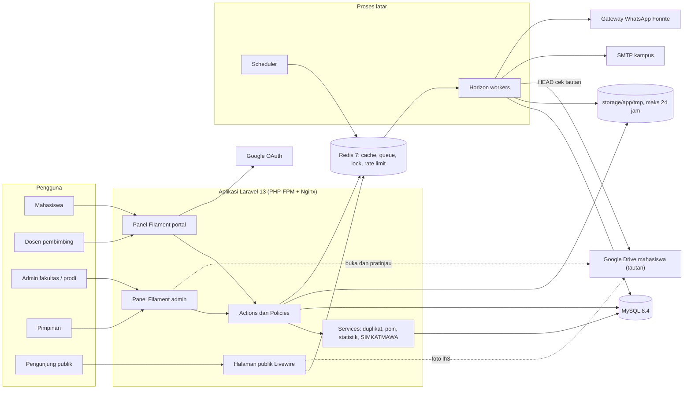

# 02 — Arsitektur Puspresma FKIP Unsil

Turunan dari `STANDAR-TEKNIS.md`. Bila ada perbedaan, `STANDAR-TEKNIS.md` yang berlaku.

## 1. Stack spesifik

| Lapisan | Pilihan | Catatan khusus Puspresma |
|---|---|---|
| Runtime | PHP 8.4, Laravel `^13.0` | `APP_NAME="Puspresma FKIP Unsil"` |
| Basis data | MySQL 8.4 LTS, `utf8mb4_0900_ai_ci` | FULLTEXT pada `prestasi(nama_kegiatan, penyelenggara)` dan `kompetisi(judul, penyelenggara, deskripsi)` |
| Redis 7 | DB 40 default, 41 cache, 42 queue | Antrean `notifikasi`, `ekspor`, `impor`, `berkas`, `default` |
| Back-office | Filament 5 (Livewire 4) | Dua panel: `admin` dan `portal` |
| Publik | Blade + Livewire 4 + Tailwind 4 (Vite) | Galeri, katalog kompetisi, verifikasi surat |
| Antrean | Laravel Horizon | `/horizon` hanya `super-admin` |
| Uji | Pest 4, Larastan level 6, Pint | CI GitHub Actions dengan MySQL 8.4 + Redis 7 |

## 2. Paket Composer

| Paket | Jenis | Alasan |
|---|---|---|
| `laravel/framework:^13.0` | prod | Kerangka utama |
| `filament/filament:^5.0` | prod | Panel admin & portal, tabel, form wizard, import/export action, notifikasi database, MFA |
| `spatie/laravel-permission` | prod | Peran & permission (`PeranDanIzinSeeder`) |
| `spatie/laravel-activitylog` | prod | Jejak audit prestasi, tautan bukti (URL lama → baru), pembukaan tautan oleh verifikator, bobot poin, pengaturan |
| `laravel/horizon` | prod | Monitor antrean Redis |
| `laravel/socialite` | prod | Login Google opsional (domain kampus) |
| `barryvdh/laravel-dompdf` | prod | PDF rekap, rekap pribadi, Surat Keterangan Prestasi |
| `spatie/simple-excel` | prod | Baca XLSX impor mahasiswa/dosen; tulis ekspor SIMKATMAWA & LAP-02/03/04 secara streaming |
| `endroid/qr-code` | prod | QR verifikasi Surat Keterangan Prestasi |
| `mews/purifier` | prod | Sanitasi HTML rich text deskripsi kompetisi & prestasi (cegah XSS) |
| `spatie/laravel-backup` | prod | Backup harian database MySQL (tidak ada berkas pengguna di server) |
| `pestphp/pest:^4`, `pestphp/pest-plugin-laravel` | dev | Uji |
| `larastan/larastan` | dev | Analisis statis level 6 |
| `laravel/pint` | dev | Format kode |
| `laravel/boost` | dev | MCP & pedoman versi untuk agen AI |
| — (tanpa Sail) | dev | Lingkungan lokal = Docker FKIP (STANDAR-TEKNIS §2) |

Catatan: kompatibilitas setiap paket dengan Laravel 13 / Filament 5 dicek saat instalasi (Laravel Boost `search-docs`). Bila `mews/purifier` belum mendukung Laravel 13, ganti dengan `stevebauman/purify` (keduanya berbasis HTMLPurifier).

## 3. Paket NPM

| Paket | Alasan |
|---|---|
| `vite`, `laravel-vite-plugin` | Build aset |
| `tailwindcss@^4`, `@tailwindcss/vite` | Gaya halaman publik |
| `@tailwindcss/typography` | Tampilan deskripsi kompetisi (rich text) |

Alpine.js sudah dibawa Livewire 4; tidak dipasang terpisah.

## 4. Pemakaian Redis

### 4.1 Cache (store `redis`, DB 41)

| Kunci | Isi | TTL | Invalidasi |
|---|---|---|---|
| `master:prodi` | Daftar prodi aktif (id, kode, nama) | selamanya | `ProdiObserver` saved/deleted |
| `master:jenis-kegiatan`, `master:kategori-lomba`, `master:tingkat`, `master:capaian:{jenis_kegiatan_id}` | Opsi formulir | selamanya | Observer model master |
| `master:bobot-poin` | Peta `jenis:tingkat:capaian → [{berlaku_mulai, poin}]` | selamanya | `BobotPoinObserver` |
| `pengaturan:semua` | Semua kunci-nilai `pengaturan` | selamanya | `Pengaturan::setel()` |
| `statistik:v{versi}:{tahun}:{prodi_id|semua}` | Agregat dasbor (per jenis, tingkat, capaian, prodi, bulan) | 30 menit, `Cache::flexible([600, 1800])` | Naikkan `statistik:versi` saat prestasi masuk/keluar `terverifikasi` |
| `galeri:v{versi}:daftar:{md5(filter)}:{halaman}` | Kartu galeri (data publik saja) | 10 menit | Naikkan `galeri:versi` saat verifikasi, persetujuan publikasi berubah, moderasi |
| `galeri:v{versi}:item:{id}` | Detail publik | 10 menit | sama |
| `katalog:v{versi}:aktif:{md5(filter)}` | Kompetisi terbit | 10 menit | `KompetisiObserver` |
| `verifikasi-surat:{id}` | Ringkasan publik surat | 1 jam | Saat surat dicabut |

Pola "versi" (`Cache::increment('galeri:versi')`) dipakai alih-alih cache tags agar invalidasi murah dan atomik.

### 4.2 Antrean (DB 42) & job

| Antrean | Job / proses | Pemicu |
|---|---|---|
| `notifikasi` | Semua `Notification` `ShouldQueue` (mail, database, WhatsApp) | Event status prestasi, konfirmasi pembimbing, katalog |
| `default` | `DeteksiDuplikatPrestasi`, `HitungPoinPrestasi` | Action `AjukanPrestasi`, `VerifikasiPrestasi` |
| `berkas` | `PeriksaTautanBerkas` (HEAD/GET tanpa unduh isi, timeout 10 detik) | Tautan disimpan/diubah; penjadwal mingguan |
| `impor` | `ImporMahasiswaDariExcel`, `ImporDosenDariExcel` (chunk 500 baris) | Halaman impor admin |
| `ekspor` | `EksporRekapPrestasi` (XLSX/PDF), `EksporSimkatmawa`, `EksporPeringkatPoin` (hanya ekspor besar; hasil di `storage/app/tmp` ≤ 24 jam) | Halaman Laporan |

Horizon: supervisor `notifikasi` (2 proses), `default,berkas` (2), `impor,ekspor` (1, `timeout` 600 detik, memori 512 MB).

### 4.3 Atomic lock

| Kunci lock | Tujuan | Durasi |
|---|---|---|
| `lock:prestasi:{id}:status` | Mencegah dua verifikator mengubah status bersamaan (dipadukan `lockForUpdate()`) | 10 detik |
| `lock:nomor-registrasi:{tahun}` | Penomoran `PRS-YYYY-NNNNN` saat pertama kali diajukan | 10 detik |
| `lock:nomor-surat-prestasi:{tahun}` | Penomoran Surat Keterangan Prestasi | 10 detik |
| `lock:impor:{jenis}` | Satu impor per jenis berjalan (BR-19) | 15 menit |
| `lock:ekspor:{user_id}:{jenis}` | Cegah klik ganda ekspor berat | 2 menit |

### 4.4 Rate limit (`RateLimiter::for` di `AppServiceProvider`)

| Nama | Batas | Kunci |
|---|---|---|
| `login` | 5/menit | email + IP |
| `google-callback` | 10/menit | IP |
| `ajukan-prestasi` | 10/jam | user_id |
| `simpan-tautan` | 60/jam | user_id |
| `buka-tautan` | 120/jam | user_id |
| `galeri` | 60/menit | IP |
| `katalog-publik` | 60/menit | IP |
| `verifikasi-surat` | 30/menit | IP |
| `ekspor` | 10/jam | user_id |

## 5. Layanan opsional

| Layanan | Rekomendasi | Alasan |
|---|---|---|
| MinIO | Tidak dipakai | Hanya relevan bila kebijakan tautan (STANDAR-TEKNIS §1a) dicabut; cukup menambah implementasi `PenyimpananBerkas` |
| Meilisearch | Tidak perlu di v1 | FULLTEXT MySQL cukup untuk pencarian nama kegiatan/kompetisi |
| Gotenberg | Opsional | Hanya bila tata letak Surat Keterangan Prestasi harus presisi kop resmi |
| Reverb | Tidak perlu | Notifikasi database Filament dengan polling cukup |

## 6. Struktur folder `app/`

```text
app/
├── Actions/
│   ├── Prestasi/      AjukanPrestasi, TarikKembaliPrestasi, LoloskanTahapProdi, KembalikanUntukPerbaikan,
│   │                  VerifikasiPrestasi, TolakPrestasi, BukaVerifikasiPrestasi, SimpanAnggotaTim
│   ├── Bukti/         SimpanTautanBukti, HapusTautanBukti, GantiTautanTerverifikasi, SimpanSnapshotTautan
│   ├── Pembimbing/    KonfirmasiPembimbingan, SangkalPembimbingan
│   ├── Duplikat/      TinjauKandidatDuplikat
│   ├── Poin/          HitungPoinPrestasi, HitungUlangPoinMassal
│   ├── Galeri/        UbahPersetujuanPublikasi, SembunyikanDariGaleri
│   ├── Katalog/       TerbitkanKompetisi, ArsipkanKompetisiKedaluwarsa
│   ├── Simkatmawa/    TandaiDilaporkanSimkatmawa
│   └── Surat/         TerbitkanSuratKeteranganPrestasi, CabutSuratKeteranganPrestasi
├── Enums/             StatusPrestasi, StatusKonfirmasiPembimbing, BentukPartisipasi, BidangPrestasi, ModaKegiatan,
│                      JenisTautan, PenyediaTautan, StatusCekTautan, StatusTinjauDuplikat, AlasanDuplikat, StatusKompetisi, StatusMahasiswa,
│                      StatusBerkasEkspor, StatusSurat, PeranAnggota, ModePoinTim
├── Exceptions/        TransisiTidakSah, PrestasiTerkunci
├── Filament/
│   ├── Admin/         (panel admin) Resources, Pages, Widgets
│   └── Portal/        (panel portal) Resources, Pages, Widgets
├── Contracts/         PenyimpananBerkas
├── Http/Controllers/  GoogleAuthController, BukaTautanController, UnduhBerkasEksporController,
│                      VerifikasiSuratController, HealthController
├── Jobs/              DeteksiDuplikatPrestasi, PeriksaTautanBerkas, ImporMahasiswaDariExcel, ImporDosenDariExcel,
│                      EksporRekapPrestasi, EksporSimkatmawa, EksporPeringkatPoin, KirimPengingatTenggatKompetisi
├── Livewire/Publik/   GaleriPrestasi, DetailPrestasiPublik, KatalogKompetisi, DetailKompetisi
├── Models/            User, Prodi, Mahasiswa, Dosen, JenisKegiatan, KategoriLomba, Tingkat, Capaian, BobotPoin,
│                      Pengaturan, Prestasi, PrestasiAnggota, PrestasiAnggotaEksternal, TautanBerkas,
│                      SnapshotTautanVerifikasi,
│                      RiwayatStatusPrestasi, KandidatDuplikat, Kompetisi, KompetisiMinat,
│                      SuratKeteranganPrestasi, RiwayatImpor, BerkasEkspor
├── Notifications/     PrestasiDiajukan, PrestasiPerluPerbaikan, PrestasiTerverifikasi, PrestasiDitolak,
│                      PermintaanKonfirmasiPembimbing, PembimbingMenyangkal, KandidatDuplikatDitemukan,
│                      KompetisiBaruTerbit, PengingatTenggatKompetisi, RingkasanAntreanVerifikasi,
│                      PengingatKonfirmasiPembimbing, TautanBerkasTidakDapatDiakses, BerkasEksporSiap, ImporSelesai
├── Notifications/Channels/ WhatsAppChannel (Fonnte)
├── Observers/         PrestasiObserver, ProdiObserver, MasterObserver, BobotPoinObserver, KompetisiObserver,
│                      TautanBerkasObserver
├── Rules/             TautanBerkasValid
├── Policies/          PrestasiPolicy, TautanBerkasPolicy, KandidatDuplikatPolicy, MahasiswaPolicy, DosenPolicy,
│                      KompetisiPolicy, BobotPoinPolicy, SuratKeteranganPrestasiPolicy, BerkasEksporPolicy, UserPolicy,
│                      MasterPolicy (prodi/jenis/kategori/tingkat/capaian)
├── Services/          Berkas/TautanEksternal, DeteksiDuplikatService, PenghitungPoin, StatistikPrestasi, PemetaanSimkatmawa,
│                      NormalisasiTeks, Pengaturan (facade-like helper)
└── Support/           ProdiScope (helper cakupan admin-prodi)
config/
├── berkas.php         Mode berkas (tautan), daftar putih domain, pemendek URL ditolak (STANDAR-TEKNIS §1a)
├── puspresma.php      Daftar domain email, nama antrean
└── simkatmawa.php     Pemetaan kolom ekspor (header ← sumber data), dapat diubah tanpa ubah kode
```

## 7. Panel Filament & Resource

### Panel `admin` (`/admin`) — `super-admin`, `admin-fakultas`, `admin-prodi`, `pimpinan`

| Grup navigasi | Resource / Page | Peran |
|---|---|---|
| Prestasi | `PrestasiResource` (antrean verifikasi, semua prestasi, tab status, aksi verifikasi, relation manager Anggota, Tautan Bukti (pratinjau Drive, tombol Buka berkas, status cek), Riwayat Status, Kandidat Duplikat, Snapshot Tautan) | admin-fakultas, admin-prodi (scope), pimpinan (lihat) |
| Prestasi | `KandidatDuplikatResource` (daftar global kandidat belum ditinjau) | admin-fakultas |
| Katalog | `KompetisiResource` | admin-fakultas, admin-prodi |
| Galeri | `ModerasiGaleri` (Page: prestasi tampil di galeri, sembunyikan) | admin-fakultas |
| Laporan | `Dasbor` (widgets statistik), `Laporan` (Page: form filter + ekspor LAP-01..06, LAP-09), `EksporSimkatmawa` (Page), `BerkasEksporResource` (unduhan hasil ekspor besar, ≤ 24 jam) | admin-fakultas, admin-prodi, pimpinan |
| Laporan | `SuratKeteranganPrestasiResource` | admin-fakultas |
| Poin | `BobotPoinResource` + Page `MatriksBobotPoin` (grid tingkat × capaian), `PeringkatPoin` (Page) | admin-fakultas |
| Master | `MahasiswaResource` (+ `ImporMahasiswa` Page), `DosenResource` (+ `ImporDosen`), `ProdiResource`, `JenisKegiatanResource`, `KategoriLombaResource`, `TingkatResource`, `CapaianResource`, `RiwayatImporResource` | admin-fakultas (admin-prodi lihat mahasiswa prodi) |
| Sistem | `UserResource`, `PengaturanPage`, `ActivityLogResource` (read-only), tautan Horizon | super-admin, admin-fakultas (pengaturan domain) |

### Panel `portal` (`/portal`) — `mahasiswa`, `dosen`

| Resource / Page | Peran | Isi |
|---|---|---|
| `PrestasiSayaResource` | mahasiswa | Wizard 4 langkah: Kegiatan → Capaian & Tingkat → Tim & Pembimbing → Tautan Bukti & Publikasi; aksi Ajukan, Tarik Kembali; tampilan catatan perbaikan & riwayat |
| `PersetujuanPublikasi` (Page) | mahasiswa | Daftar prestasi saya (termasuk sebagai anggota) dengan sakelar setuju publikasi |
| `KatalogKompetisi` (Page) | mahasiswa, dosen | Kompetisi terbit + tombol Berminat |
| `PoinSaya` (Page) | mahasiswa | Total poin per periode, unduh rekap PDF (LAP-07) |
| `KonfirmasiPembimbingResource` | dosen | Permintaan konfirmasi; aksi Konfirmasi / Sangkal |
| `PrestasiBimbinganResource` | dosen | Prestasi yang dikonfirmasi dibimbing (baca saja) |
| `ProfilNotifikasi` (Page) | semua | Nomor WA, sakelar notifikasi WA |

Login kedua panel: form lokal + tombol "Masuk dengan Google" (bila `GOOGLE_LOGIN_ENABLED=true`). Pengguna yang membuka panel yang bukan haknya diarahkan ke panel yang sesuai (`User::canAccessPanel()`).

## 8. Halaman publik & route

| Route | Nama | Komponen | Middleware |
|---|---|---|---|
| `GET /` | `beranda` | Blade: sorotan prestasi terbaru (dari cache galeri) + kompetisi dibuka | `throttle:galeri` |
| `GET /galeri` | `galeri.index` | Livewire `Publik\GaleriPrestasi` (filter tahun, tingkat, prodi, jenis) | `throttle:galeri` |
| `GET /galeri/{prestasi}` | `galeri.show` | Livewire `Publik\DetailPrestasiPublik` | `throttle:galeri` |
| `GET /kompetisi` | `kompetisi.index` | Livewire `Publik\KatalogKompetisi` | `throttle:katalog-publik` |
| `GET /kompetisi/{kompetisi:slug}` | `kompetisi.show` | Livewire `Publik\DetailKompetisi` | `throttle:katalog-publik` |
| `GET /verifikasi/{id}` | `verifikasi.surat` | `VerifikasiSuratController` | `throttle:verifikasi-surat` |
| `GET /auth/google/redirect`, `/auth/google/callback` | `auth.google.*` | `GoogleAuthController` | `guest`, `throttle:google-callback` |
| `GET /tautan/{tautanBerkas}/buka` | `tautan.buka` | `BukaTautanController` (Policy `view`, catat activitylog, redirect ke URL) | `auth`, `throttle:buka-tautan` |
| `GET /ekspor/{berkasEkspor}/unduh` | `ekspor.unduh` | `UnduhBerkasEksporController` (stream dari `storage/app/tmp`, hanya pemohon, ≤ 24 jam) | `auth` |
| `GET /api/health` | `health` | `HealthController` (DB, Redis, queue size) | — |

Foto galeri dimuat langsung oleh browser dari `https://lh3.googleusercontent.com/d/<drive_file_id>` (tidak lewat server); bila gagal dimuat tampil placeholder.

Footer semua halaman: versi aplikasi (`config('app.version')` dari tag git), tautan kebijakan privasi galeri, tautan kanal resmi pelaporan kekerasan universitas (bila tersedia; tidak dibangun).

## 9. Penjadwal (`routes/console.php`)

| Jadwal | Perintah / job | Keterangan |
|---|---|---|
| Setiap 5 menit | `horizon:snapshot` | Metrik Horizon |
| Harian 00:30 | `puspresma:arsipkan-kompetisi` | BR-23 |
| Harian 01:00 | `backup:run --only-db` | spatie/laravel-backup (database saja) |
| Harian 01:30 | `backup:clean` | Retensi 30 hari |
| Setiap jam | `puspresma:bersihkan-tmp` | Hapus berkas di `storage/app/tmp` berumur > 24 jam (ekspor, impor, berkas galat) dan tandai `berkas_ekspor` kedaluwarsa (BR-25) |
| Minggu 02:00 | `puspresma:periksa-tautan` | Dispatch `PeriksaTautanBerkas` untuk tautan aktif (chunk 200, jeda antar-permintaan); kirim `TautanBerkasTidakDapatDiakses` bila berubah menjadi tidak dapat diakses (BR-30) |
| Harian 07:00 | `KirimPengingatTenggatKompetisi` | H-3 & H-1 bagi mahasiswa berminat |
| Harian 07:30 (Senin–Jumat) | `puspresma:ringkasan-antrean` | `RingkasanAntreanVerifikasi` ke admin fakultas/prodi |
| Senin 08:00 | `puspresma:pengingat-pembimbing` | Permintaan `menunggu` > 7 hari |
| Bulanan tgl 1, 03:00 | `activitylog:clean` | Retensi log mengikuti `config/activitylog.php` (usulan 730 hari, **perlu ditetapkan fakultas**) |
| Bulanan tgl 1, 03:30 | `queue:prune-failed --hours=720` | Bersihkan job gagal lama |

Semua jadwal memakai `->onOneServer()->withoutOverlapping()` (lock Redis).

## 10. Notifikasi

| Notifikasi | Penerima | Kanal |
|---|---|---|
| `PrestasiDiajukan` | admin-prodi (prodi pengaju, bila tahap 1 aktif) atau admin-fakultas | database |
| `PrestasiPerluPerbaikan` | Semua anggota internal (pengaju utama + anggota) | mail, database, WA (opt-in) |
| `PrestasiTerverifikasi` | Semua anggota internal; dosen pembimbing | mail, database, WA (opt-in) |
| `PrestasiDitolak` | Pengaju | mail, database, WA (opt-in) |
| `PermintaanKonfirmasiPembimbing` | Dosen pembimbing | mail, database |
| `PembimbingMenyangkal` | Admin fakultas, pengaju | database, mail |
| `KandidatDuplikatDitemukan` | Admin fakultas | database |
| `KompetisiBaruTerbit` | Mahasiswa prodi sasaran (dikirim per chunk 200, hanya database; mail opsional ringkasan mingguan) | database |
| `PengingatTenggatKompetisi` | Mahasiswa berminat | mail, database, WA (opt-in) |
| `RingkasanAntreanVerifikasi` | Admin fakultas/prodi | mail |
| `PengingatKonfirmasiPembimbing` | Dosen | mail |
| `TautanBerkasTidakDapatDiakses` | Pengaju (dan admin-fakultas bila prestasi terverifikasi) | database, mail |
| `BerkasEksporSiap`, `ImporSelesai` | Pemohon | database |

`WhatsAppChannel` memanggil gateway Fonnte (`FONNTE_TOKEN`, `FONNTE_URL` di `.env`), hanya bila `pengaturan.wa_aktif = true`, `users.notif_wa_aktif = true`, dan `users.nomor_wa` terisi. Gagal kirim WA tidak menggagalkan kanal lain (retry 3×, backoff 60 detik).

## 11. Strategi berkas: tautan, bukan unggahan (STANDAR-TEKNIS §1a)

**Tidak ada berkas pengguna yang disimpan di server.** Semua bukti dan poster berupa tautan di tabel polimorfik `tautan_berkas`.

| Komponen | Isi |
|---|---|
| `config/berkas.php` | `mode` = `env('BERKAS_MODE', 'tautan')`; `domain_diizinkan` = `drive.google.com`, `docs.google.com`, `*.unsil.ac.id` (opsional `onedrive.live.com`, `*.sharepoint.com`); `pemendek_ditolak` = `bit.ly`, `s.id`, `tinyurl.com`, `goo.gl`, dsb.; `timeout_cek` = 10 |
| `App\Contracts\PenyimpananBerkas` | Antarmuka tunggal akses berkas: `simpanTautan(Model $pemilik, string $jenis, string $url, ?string $label, User $u): TautanBerkas`, `urlBuka(TautanBerkas)`, `urlPratinjau(TautanBerkas): ?string`, `urlGambar(TautanBerkas): ?string` |
| `App\Services\Berkas\TautanEksternal` | Implementasi aktif (`BERKAS_MODE=tautan`): normalisasi URL, ekstraksi `drive_file_id` (pola `/file/d/<id>`, `open?id=<id>`, `uc?id=<id>`, `/document/d/<id>`), penentuan `penyedia`; pratinjau `https://drive.google.com/file/d/<id>/preview`; gambar `https://lh3.googleusercontent.com/d/<id>`. Kelak cukup menambah `DiskLokal`/`S3` dan mengganti binding |
| `App\Rules\TautanBerkasValid` | Hanya `https://`; domain daftar putih; tolak pemendek URL; tolak tautan folder Drive (`/drive/folders/`) karena yang diminta satu berkas; panjang ≤ 2048 |
| `App\Jobs\PeriksaTautanBerkas` | Antrean `berkas`: HTTP HEAD (fallback GET dengan `Range: bytes=0-0`) tanpa cookie/login, timeout 10 detik, tanpa mengunduh isi; isi `status_cek` & `dicek_pada`. Dipicu saat simpan dan ulang mingguan. Hasil informatif, tidak memblokir |
| `TautanBerkasObserver` | Mencatat activitylog URL lama → baru; menaikkan `galeri:versi` bila tautan foto berubah; dispatch `PeriksaTautanBerkas` |
| `BukaTautanController` | Route `tautan.buka`: cek `TautanBerkasPolicy::view`, catat activitylog (log `tautan`, siapa/kapan/tautan), lalu `redirect()->away($url)`; dipakai tombol "Buka berkas" (`target="_blank" rel="noopener noreferrer"`) agar BR-29 dapat dibuktikan |
| Snapshot | `App\Actions\Bukti\SimpanSnapshotTautan` dipanggil di dalam transaksi `VerifikasiPrestasi` → `snapshot_tautan_verifikasi` (BR-28) |

**Keluaran yang dihasilkan sistem** (ekspor Excel/PDF, Surat Keterangan Prestasi, QR) di-stream langsung ke browser. Ekspor besar lewat antrean ditulis sementara ke `storage/app/tmp/ekspor/{user_id}/` dan dihapus otomatis ≤ 24 jam; berkas Excel impor ditulis ke `storage/app/tmp/impor/` dan dihapus segera setelah diproses. QR dibangkitkan *on-the-fly* (data URI). Disk `tmp` (driver local, root `storage_path('app/tmp')`) satu-satunya disk tulis aplikasi.

**Petunjuk privasi di formulir** (BR-31): sertifikat/piagam dan foto penyerahan boleh "Siapa saja yang memiliki link" (foto wajib publik bila ingin tampil di galeri); surat tugas atau dokumen berisi NIK/NIP/nilai dibagikan terbatas ke akun/organisasi kampus atau akun verifikator. Ingatkan juga agar foto tidak memuat data lokasi, karena sistem tidak dapat membuang EXIF dari berkas Drive.

**CSP**: `img-src` mengizinkan `https://lh3.googleusercontent.com`; `frame-src` mengizinkan `https://drive.google.com` dan `https://docs.google.com`.

## 12. Diagram komponen



## 13. Variabel `.env` khusus

```dotenv
APP_NAME="Puspresma FKIP Unsil"
APP_VERSION=0.0.0                     # diisi saat build dari git tag
GOOGLE_LOGIN_ENABLED=false
GOOGLE_CLIENT_ID=
GOOGLE_CLIENT_SECRET=
GOOGLE_REDIRECT_URI="${APP_URL}/auth/google/callback"
PUSPRESMA_DOMAIN_MAHASISWA=student.unsil.ac.id
PUSPRESMA_DOMAIN_PEGAWAI=unsil.ac.id
FONNTE_URL=https://api.fonnte.com/send   # perlu verifikasi endpoint terbaru
FONNTE_TOKEN=
BERKAS_MODE=tautan                    # STANDAR-TEKNIS §1a
BACKUP_ARCHIVE_PASSWORD=
```
