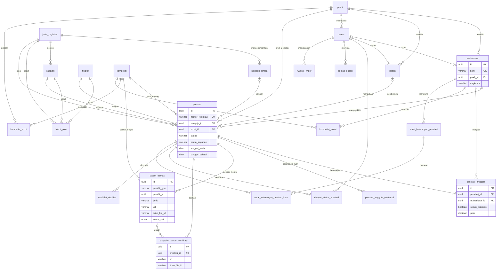

# 03 — Skema Basis Data Puspresma

MySQL 8.4, InnoDB, `utf8mb4_0900_ai_ci`. Nama tabel/kolom bahasa Indonesia `snake_case`. Semua primary key `id` **UUIDv7** CHAR(36) (`HasUuids`, STANDAR-TEKNIS §4a); FK `foreignUuid`, polimorfik `uuidMorphs`; URL, QR, dan API memakai `id` yang sama (tanpa kolom `ulid`). `created_at`/`updated_at` (`TIMESTAMP NULL`) ada di semua tabel kecuali dinyatakan lain dan tidak diulang di tabel kolom di bawah.

## 1. ERD

## 2. Enum (PHP Enum, disimpan sebagai `VARCHAR`)

Disimpan sebagai `VARCHAR(30)` (bukan `ENUM` MySQL) agar penambahan nilai tidak memerlukan `ALTER` berisiko; validasi oleh PHP Enum + cast.

| Enum (`app/Enums`) | Nilai | Label |
|---|---|---|
| `StatusPrestasi` | `draf`, `diajukan`, `lolos_prodi`, `perlu_perbaikan`, `terverifikasi`, `ditolak` | Draf, Diajukan, Lolos Tahap Prodi, Perlu Perbaikan, Terverifikasi, Ditolak |
| `StatusKonfirmasiPembimbing` | `tidak_ada`, `menunggu`, `dikonfirmasi`, `disangkal` | — |
| `BentukPartisipasi` | `individu`, `kelompok` | Individu, Kelompok/Tim |
| `BidangPrestasi` | `akademik`, `non_akademik` | Akademik, Non-akademik |
| `ModaKegiatan` | `luring`, `daring`, `hibrida` | — |
| `JenisTautan` | `sertifikat_piagam`, `foto_penyerahan`, `surat_tugas`, `lainnya`, `poster` | Sertifikat/Piagam, Foto Penyerahan, Surat Tugas, Lainnya, Poster (kompetisi) |
| `PenyediaTautan` | `google_drive`, `google_docs`, `onedrive`, `unsil`, `lainnya` | Disimpan sebagai ENUM MySQL di `tautan_berkas` (STANDAR-TEKNIS §1a) |
| `StatusCekTautan` | `belum`, `dapat_diakses`, `tidak_dapat_diakses` | idem |
| `PeranAnggota` | `ketua`, `anggota` | — |
| `StatusTinjauDuplikat` | `belum_ditinjau`, `bukan_duplikat`, `duplikat` | — |
| `AlasanDuplikat` | `kemiripan_kegiatan`, `tautan_sama` | `tautan_sama` = `drive_file_id` sama atau `url_normal` sama |
| `StatusKompetisi` | `draf`, `terbit`, `diarsipkan` | — |
| `StatusMahasiswa` | `aktif`, `cuti`, `lulus`, `keluar`, `nonaktif` | — |
| `StatusBerkasEkspor` | `antre`, `proses`, `selesai`, `gagal`, `kedaluwarsa` | — |
| `StatusSurat` | `aktif`, `dicabut` | — |
| `ModePoinTim` | `penuh`, `dibagi` | — |
| `JenjangProdi` | `S1`, `S2`, `S3`, `Profesi` | — |

## 3. Tabel

### 3.1 `users` (modifikasi bawaan Laravel)

| Kolom | Tipe | Null | Default | Indeks/FK | Keterangan |
|---|---|---|---|---|---|
| `name` | VARCHAR(150) | tidak | | | |
| `email` | VARCHAR(191) | tidak | | UNIQUE | Akun kampus |
| `email_verified_at` | TIMESTAMP | ya | | | |
| `password` | VARCHAR(255) | ya | | | NULL untuk akun Google-only |
| `google_id` | VARCHAR(64) | ya | | UNIQUE | |
| `npm` | VARCHAR(20) | ya | | INDEX | Kesiapan FKIP Edu |
| `nidn` | VARCHAR(20) | ya | | INDEX | |
| `nip` | VARCHAR(30) | ya | | INDEX | |
| `prodi_id` | CHAR(36) | ya | | FK `prodi.id` SET NULL | Cakupan admin-prodi/pimpinan prodi |
| `nomor_wa` | VARCHAR(20) | ya | | | Format `62…` |
| `notif_wa_aktif` | TINYINT(1) | tidak | 0 | | Opt-in |
| `is_active` | TINYINT(1) | tidak | 1 | INDEX | |
| `last_login_at` | DATETIME | ya | | | |
| `app_authentication_secret` | TEXT | ya | | | MFA Filament (nama kolom ikuti dokumentasi Filament 5, cek via Boost) |
| `app_authentication_recovery_codes` | TEXT | ya | | | |
| `remember_token` | VARCHAR(100) | ya | | | |

### 3.2 `prodi`

| Kolom | Tipe | Null | Default | Indeks/FK | Keterangan |
|---|---|---|---|---|---|
| `kode` | VARCHAR(20) | tidak | | UNIQUE | Kode internal (dipakai di berkas impor) |
| `kode_pddikti` | VARCHAR(10) | ya | | | Untuk ekspor SIMKATMAWA |
| `nama` | VARCHAR(150) | tidak | | | |
| `jenjang` | VARCHAR(10) | tidak | `S1` | | `JenjangProdi` |
| `kode_eksternal` | VARCHAR(50) | ya | | INDEX | Pemetaan FKIP Edu |
| `is_active` | TINYINT(1) | tidak | 1 | | |
| `deleted_at` | TIMESTAMP | ya | | | Soft delete |

### 3.3 `mahasiswa`

| Kolom | Tipe | Null | Default | Indeks/FK | Keterangan |
|---|---|---|---|---|---|
| `npm` | VARCHAR(20) | tidak | | UNIQUE | Kunci impor |
| `nama` | VARCHAR(150) | tidak | | FULLTEXT(`nama`) opsional; INDEX | |
| `prodi_id` | CHAR(36) | tidak | | FK `prodi.id` RESTRICT; INDEX(`prodi_id`,`angkatan`) | |
| `angkatan` | SMALLINT UNSIGNED | tidak | | | Tahun masuk |
| `email` | VARCHAR(191) | ya | | UNIQUE | `@student.unsil.ac.id` |
| `nomor_hp` | VARCHAR(20) | ya | | | Data pribadi (BR-26) |
| `status_mahasiswa` | VARCHAR(20) | tidak | `aktif` | INDEX | `StatusMahasiswa` |
| `user_id` | CHAR(36) | ya | | UNIQUE, FK `users.id` SET NULL | |
| `kode_eksternal` | VARCHAR(50) | ya | | INDEX | |
| `deleted_at` | TIMESTAMP | ya | | | |

### 3.4 `dosen`

| Kolom | Tipe | Null | Default | Indeks/FK | Keterangan |
|---|---|---|---|---|---|
| `nidn` | VARCHAR(20) | ya | | UNIQUE | Untuk ekspor SIMKATMAWA |
| `nip` | VARCHAR(30) | ya | | UNIQUE | |
| `nama` | VARCHAR(150) | tidak | | INDEX | Tanpa gelar |
| `gelar_depan` | VARCHAR(30) | ya | | | |
| `gelar_belakang` | VARCHAR(60) | ya | | | |
| `prodi_id` | CHAR(36) | ya | | FK `prodi.id` SET NULL | |
| `email` | VARCHAR(191) | ya | | UNIQUE | `@unsil.ac.id` |
| `user_id` | CHAR(36) | ya | | UNIQUE, FK `users.id` SET NULL | |
| `kode_eksternal` | VARCHAR(50) | ya | | INDEX | Pemetaan sistem SDM |
| `deleted_at` | TIMESTAMP | ya | | | |

### 3.5 `jenis_kegiatan`

| Kolom | Tipe | Null | Default | Indeks/FK | Keterangan |
|---|---|---|---|---|---|
| `kode` | VARCHAR(30) | tidak | | UNIQUE | `kompetisi`, `rekognisi`, … |
| `nama` | VARCHAR(100) | tidak | | | |
| `deskripsi` | TEXT | ya | | | |
| `kode_simkatmawa` | VARCHAR(50) | ya | | | **perlu verifikasi** |
| `wajib_penyelenggara` | TINYINT(1) | tidak | 1 | | |
| `urutan` | SMALLINT | tidak | 0 | | |
| `is_active` | TINYINT(1) | tidak | 1 | | |
| `deleted_at` | TIMESTAMP | ya | | | |

### 3.6 `kategori_lomba`

| Kolom | Tipe | Null | Default | Indeks/FK | Keterangan |
|---|---|---|---|---|---|
| `jenis_kegiatan_id` | CHAR(36) | ya | | FK `jenis_kegiatan.id` | NULL = berlaku semua jenis |
| `nama` | VARCHAR(100) | tidak | | UNIQUE(`jenis_kegiatan_id`,`nama`) | Sains, Teknologi, Seni, Olahraga, dsb. |
| `kode_simkatmawa` | VARCHAR(50) | ya | | | |
| `is_active` | TINYINT(1) | tidak | 1 | | |
| `deleted_at` | TIMESTAMP | ya | | | |

### 3.7 `tingkat`

| Kolom | Tipe | Null | Default | Indeks/FK | Keterangan |
|---|---|---|---|---|---|
| `kode` | VARCHAR(30) | tidak | | UNIQUE | `lokal`, `wilayah`, `nasional`, `internasional` |
| `nama` | VARCHAR(100) | tidak | | | |
| `urutan` | SMALLINT | tidak | 0 | | Untuk filter "tingkat minimal" (LAP-04) |
| `kode_simkatmawa` | VARCHAR(50) | ya | | | |
| `is_active` | TINYINT(1) | tidak | 1 | | |
| `deleted_at` | TIMESTAMP | ya | | | |

### 3.8 `capaian`

| Kolom | Tipe | Null | Default | Indeks/FK | Keterangan |
|---|---|---|---|---|---|
| `jenis_kegiatan_id` | CHAR(36) | tidak | | FK; UNIQUE(`jenis_kegiatan_id`,`kode`) | |
| `kode` | VARCHAR(40) | tidak | | | `juara-1`, `narasumber`, … |
| `nama` | VARCHAR(100) | tidak | | | |
| `is_juara` | TINYINT(1) | tidak | 0 | | Untuk filter IKU |
| `urutan` | SMALLINT | tidak | 0 | | |
| `kode_simkatmawa` | VARCHAR(50) | ya | | | |
| `is_active` | TINYINT(1) | tidak | 1 | | |
| `deleted_at` | TIMESTAMP | ya | | | |

### 3.9 `bobot_poin`

| Kolom | Tipe | Null | Default | Indeks/FK | Keterangan |
|---|---|---|---|---|---|
| `jenis_kegiatan_id` | CHAR(36) | tidak | | FK | |
| `tingkat_id` | CHAR(36) | tidak | | FK | |
| `capaian_id` | CHAR(36) | tidak | | FK | |
| `poin` | DECIMAL(8,2) | tidak | 0.00 | | Bukan float |
| `berlaku_mulai` | DATE | tidak | | UNIQUE(`jenis_kegiatan_id`,`tingkat_id`,`capaian_id`,`berlaku_mulai`) | |
| `berlaku_sampai` | DATE | ya | | | NULL = masih berlaku |
| `dasar_penetapan` | VARCHAR(255) | ya | | | Mis. nomor SK Dekan |

### 3.10 `pengaturan`

| Kolom | Tipe | Null | Default | Indeks/FK | Keterangan |
|---|---|---|---|---|---|
| `kunci` | VARCHAR(100) | tidak | | UNIQUE | |
| `nilai` | TEXT | ya | | | |
| `tipe` | VARCHAR(10) | tidak | `string` | | `bool`, `int`, `decimal`, `string`, `json` |
| `grup` | VARCHAR(50) | tidak | `umum` | | |
| `keterangan` | VARCHAR(255) | ya | | | |

### 3.11 `prestasi`

| Kolom | Tipe | Null | Default | Indeks/FK | Keterangan |
|---|---|---|---|---|---|
| `nomor_registrasi` | VARCHAR(20) | ya | | UNIQUE | `PRS-YYYY-NNNNN`, diisi saat pertama diajukan (lock) |
| `pengaju_id` | CHAR(36) | tidak | | FK `mahasiswa.id` RESTRICT | |
| `prodi_id` | CHAR(36) | tidak | | FK `prodi.id`; INDEX(`prodi_id`,`status`) | Snapshot prodi pengaju |
| `dibuat_oleh` | CHAR(36) | tidak | | FK `users.id` | Mahasiswa atau admin (atas nama) |
| `jenis_kegiatan_id` | CHAR(36) | tidak | | FK | |
| `bidang` | VARCHAR(20) | tidak | | INDEX | `BidangPrestasi` |
| `kategori_lomba_id` | CHAR(36) | ya | | FK SET NULL | |
| `tingkat_id` | CHAR(36) | tidak | | FK; INDEX(`tahun`,`tingkat_id`) | |
| `capaian_id` | CHAR(36) | tidak | | FK | |
| `capaian_keterangan` | VARCHAR(150) | ya | | | Mis. "Juara 1 Kategori Poster" |
| `bentuk` | VARCHAR(20) | tidak | `individu` | | `BentukPartisipasi` |
| `nama_kegiatan` | VARCHAR(255) | tidak | | FULLTEXT(`nama_kegiatan`,`penyelenggara`) | |
| `nama_kegiatan_normal` | VARCHAR(255) | tidak | | INDEX | Huruf kecil, tanpa tanda baca/stopword; untuk duplikat |
| `judul_karya` | VARCHAR(255) | ya | | | |
| `penyelenggara` | VARCHAR(255) | tidak | | | |
| `url_kegiatan` | VARCHAR(500) | ya | | | |
| `tanggal_mulai` | DATE | tidak | | INDEX | |
| `tanggal_selesai` | DATE | tidak | | | |
| `tahun` | SMALLINT UNSIGNED | tidak | | INDEX | Dari `tanggal_selesai` (BR-21), diisi model |
| `moda` | VARCHAR(10) | tidak | `luring` | | `ModaKegiatan` |
| `lokasi` | VARCHAR(150) | ya | | | Kota/tempat; wajib bila luring/hibrida |
| `negara_penyelenggara` | VARCHAR(100) | tidak | `Indonesia` | | |
| `jumlah_peserta` | INT UNSIGNED | ya | | | |
| `jumlah_pt_peserta` | INT UNSIGNED | ya | | | Wajib tingkat nasional (BR-05) |
| `jumlah_negara_peserta` | SMALLINT UNSIGNED | ya | | | Wajib internasional |
| `negara_peserta` | TEXT | ya | | | Daftar negara dipisah koma |
| `dosen_pembimbing_id` | CHAR(36) | ya | | FK `dosen.id` SET NULL; INDEX(`dosen_pembimbing_id`,`status_konfirmasi_pembimbing`) | |
| `nama_pembimbing_lain` | VARCHAR(150) | ya | | | Pembimbing di luar master (tanpa konfirmasi sistem) |
| `status_konfirmasi_pembimbing` | VARCHAR(20) | tidak | `tidak_ada` | | |
| `catatan_pembimbing` | TEXT | ya | | | Alasan menyangkal |
| `dikonfirmasi_pembimbing_at` | DATETIME | ya | | | |
| `nomor_sertifikat` | VARCHAR(100) | ya | | | |
| `deskripsi` | TEXT | ya | | | Teks polos/sanitasi |
| `kompetisi_id` | CHAR(36) | ya | | FK `kompetisi.id` SET NULL | Asal katalog |
| `status` | VARCHAR(20) | tidak | `draf` | INDEX | `StatusPrestasi` |
| `diajukan_at` | DATETIME | ya | | | Pengajuan terakhir |
| `diverifikasi_at` | DATETIME | ya | | | |
| `diverifikasi_oleh` | CHAR(36) | ya | | FK `users.id` | |
| `catatan_verifikasi` | TEXT | ya | | | Catatan terakhir |
| `verifikasi_tanpa_konfirmasi` | TINYINT(1) | tidak | 0 | | BR-11 |
| `disembunyikan_dari_galeri` | TINYINT(1) | tidak | 0 | | Moderasi |
| `alasan_disembunyikan` | VARCHAR(255) | ya | | | |
| `dilaporkan_simkatmawa_at` | DATETIME | ya | | INDEX | BR-27 |
| `dilaporkan_simkatmawa_oleh` | CHAR(36) | ya | | FK `users.id` | |
| `deleted_at` | TIMESTAMP | ya | | | Hanya draf (BR-14) |

### 3.12 `prestasi_anggota`

| Kolom | Tipe | Null | Default | Indeks/FK | Keterangan |
|---|---|---|---|---|---|
| `prestasi_id` | CHAR(36) | tidak | | FK CASCADE; UNIQUE(`prestasi_id`,`mahasiswa_id`) | |
| `mahasiswa_id` | CHAR(36) | tidak | | FK RESTRICT; INDEX | |
| `prodi_id` | CHAR(36) | tidak | | FK; INDEX | Snapshot prodi anggota saat ditambahkan (statistik BR-02) |
| `peran` | VARCHAR(10) | tidak | `anggota` | | `PeranAnggota` |
| `is_pengaju` | TINYINT(1) | tidak | 0 | | |
| `setuju_publikasi` | TINYINT(1) | tidak | 0 | | BR-17 |
| `setuju_publikasi_at` | DATETIME | ya | | | |
| `poin` | DECIMAL(8,2) | ya | | | Snapshot BR-18 |

### 3.13 `prestasi_anggota_eksternal`

| Kolom | Tipe | Null | Default | Indeks/FK | Keterangan |
|---|---|---|---|---|---|
| `prestasi_id` | CHAR(36) | tidak | | FK CASCADE | |
| `nama` | VARCHAR(150) | tidak | | | |
| `nomor_induk` | VARCHAR(30) | ya | | | NIM luar FKIP |
| `institusi` | VARCHAR(150) | tidak | | | Mis. "Fakultas Teknik Unsil" |
| `program_studi` | VARCHAR(150) | ya | | | |

### 3.14 `tautan_berkas` (tabel polimorfik bersama, STANDAR-TEKNIS §1a)

Tidak ada berkas yang disimpan di server; tabel ini hanya menyimpan URL + metadata. Kolom inti mengikuti STANDAR-TEKNIS §1a persis (termasuk tipe `ENUM` untuk `penyedia` dan `status_cek` — pengecualian dari pola VARCHAR di bagian 2 demi keseragaman lintas sistem). Dua kolom terakhir adalah **perluasan khusus Puspresma**.

Di Puspresma pemiliknya: `App\Models\Prestasi` (bukti) dan `App\Models\Kompetisi` (poster).

| Kolom | Tipe | Null | Default | Indeks/FK | Keterangan |
|---|---|---|---|---|---|
| `pemilik_type` | VARCHAR(191) | tidak | | INDEX(`pemilik_type`,`pemilik_id`,`jenis`) | Morph alias: `prestasi`, `kompetisi` (`Relation::enforceMorphMap`) |
| `pemilik_id` | CHAR(36) | tidak | | | |
| `jenis` | VARCHAR(30) | tidak | | | `JenisTautan`: `sertifikat_piagam`, `foto_penyerahan`, `surat_tugas`, `lainnya`, `poster` |
| `label` | VARCHAR(255) | ya | | | Keterangan singkat; untuk foto dipakai sebagai teks alternatif galeri |
| `url` | VARCHAR(2048) | tidak | | | Hanya `https://`, lolos `TautanBerkasValid` |
| `penyedia` | ENUM(`google_drive`,`google_docs`,`onedrive`,`unsil`,`lainnya`) | tidak | | | Ditentukan dari domain |
| `drive_file_id` | VARCHAR(100) | ya | | INDEX | Diekstrak dari pola URL Drive; dasar deteksi duplikat (BR-10b) dan URL foto `lh3` |
| `status_cek` | ENUM(`belum`,`dapat_diakses`,`tidak_dapat_diakses`) | tidak | `belum` | INDEX | Hasil `PeriksaTautanBerkas` dari sisi anonim; `dapat_diakses` = dibagikan publik |
| `dicek_pada` | DATETIME | ya | | | |
| `ditambahkan_oleh` | CHAR(36) | tidak | | FK `users.id` | |
| `deleted_at` | TIMESTAMP | ya | | | Soft delete |
| `tampil_publik` | TINYINT(1) | tidak | 0 | | **Perluasan Puspresma.** Izin mahasiswa agar foto `foto_penyerahan` tampil di galeri (BR-16); diabaikan untuk jenis lain |
| `url_normal` | VARCHAR(2048) | tidak | | INDEX(`url_normal`(191)) | **Perluasan Puspresma.** URL tanpa parameter pelacak/`usp=sharing`, huruf kecil host; duplikat untuk penyedia non-Drive |

### 3.14a `snapshot_tautan_verifikasi` (tanpa `updated_at`, tidak dapat diubah)

| Kolom | Tipe | Null | Default | Indeks/FK | Keterangan |
|---|---|---|---|---|---|
| `prestasi_id` | CHAR(36) | tidak | | FK CASCADE; INDEX(`prestasi_id`,`created_at`) | |
| `tautan_berkas_id` | CHAR(36) | ya | | FK `tautan_berkas.id` SET NULL | Rujukan ke tautan asal |
| `jenis` | VARCHAR(30) | tidak | | | Disalin |
| `url` | VARCHAR(2048) | tidak | | | Disalin saat terverifikasi (BR-28) |
| `drive_file_id` | VARCHAR(100) | ya | | | Disalin |
| `status_cek` | VARCHAR(30) | tidak | | | Disalin |
| `alasan` | VARCHAR(20) | tidak | `verifikasi` | | `verifikasi` atau `penggantian` (aksi "Ganti tautan", BR-30) |
| `dibuka_verifikator` | TINYINT(1) | tidak | 0 | | Apakah verifikator membuka tautan ini sebelum verifikasi (BR-29) |
| `user_id` | CHAR(36) | tidak | | FK `users.id` | Verifikator / admin |
| `created_at` | TIMESTAMP | tidak | CURRENT_TIMESTAMP | | |

### 3.15 `riwayat_status_prestasi` (tanpa `updated_at`)

| Kolom | Tipe | Null | Default | Indeks/FK | Keterangan |
|---|---|---|---|---|---|
| `prestasi_id` | CHAR(36) | tidak | | FK CASCADE; INDEX(`prestasi_id`,`created_at`) | |
| `dari_status` | VARCHAR(20) | ya | | | NULL saat dibuat |
| `ke_status` | VARCHAR(20) | tidak | | | |
| `user_id` | CHAR(36) | tidak | | FK `users.id` | |
| `catatan` | TEXT | ya | | | |
| `created_at` | TIMESTAMP | tidak | CURRENT_TIMESTAMP | | |

### 3.16 `kandidat_duplikat`

| Kolom | Tipe | Null | Default | Indeks/FK | Keterangan |
|---|---|---|---|---|---|
| `prestasi_id` | CHAR(36) | tidak | | FK CASCADE; UNIQUE(`prestasi_id`,`pembanding_id`,`alasan`) | Prestasi yang baru diajukan |
| `pembanding_id` | CHAR(36) | tidak | | FK `prestasi.id` CASCADE | Prestasi lama yang mirip |
| `alasan` | VARCHAR(30) | tidak | | | `AlasanDuplikat` |
| `skor` | DECIMAL(5,2) | tidak | | | 0–100 |
| `status_tinjau` | VARCHAR(20) | tidak | `belum_ditinjau` | INDEX | |
| `ditinjau_oleh` | CHAR(36) | ya | | FK `users.id` | |
| `ditinjau_at` | DATETIME | ya | | | |
| `catatan` | TEXT | ya | | | |

### 3.17 `kompetisi`

| Kolom | Tipe | Null | Default | Indeks/FK | Keterangan |
|---|---|---|---|---|---|
| `slug` | VARCHAR(191) | tidak | | UNIQUE | |
| `judul` | VARCHAR(255) | tidak | | FULLTEXT(`judul`,`penyelenggara`,`deskripsi`) | |
| `penyelenggara` | VARCHAR(255) | tidak | | | |
| `jenis_kegiatan_id` | CHAR(36) | tidak | | FK | |
| `bidang` | VARCHAR(20) | ya | | | |
| `kategori_lomba_id` | CHAR(36) | ya | | FK SET NULL | |
| `tingkat_id` | CHAR(36) | ya | | FK SET NULL | |
| `deskripsi` | MEDIUMTEXT | ya | | | HTML tersanitasi |
| `url_pendaftaran` | VARCHAR(500) | ya | | | |
| `url_panduan` | VARCHAR(500) | ya | | | |
| `tanggal_buka` | DATE | ya | | | |
| `tenggat_pendaftaran` | DATETIME | tidak | | INDEX(`status`,`tenggat_pendaftaran`) | |
| `tanggal_pelaksanaan_mulai` | DATE | ya | | | |
| `tanggal_pelaksanaan_selesai` | DATE | ya | | | |
| `moda` | VARCHAR(10) | ya | | | |
| `lokasi` | VARCHAR(150) | ya | | | |
| `biaya_pendaftaran` | DECIMAL(15,2) | ya | | | Uang: DECIMAL |
| `kontak_narahubung` | VARCHAR(150) | ya | | | |
| `status` | VARCHAR(20) | tidak | `draf` | | `StatusKompetisi` |
| `diterbitkan_at` | DATETIME | ya | | | |
| `dibuat_oleh` | CHAR(36) | tidak | | FK `users.id` | |
| `deleted_at` | TIMESTAMP | ya | | | |

### 3.18 `kompetisi_prodi` (pivot, tanpa timestamps)

| Kolom | Tipe | Null | Indeks/FK | Keterangan |
|---|---|---|---|---|
| `kompetisi_id` | CHAR(36) | tidak | PK gabungan, FK CASCADE | Tanpa baris = semua prodi |
| `prodi_id` | CHAR(36) | tidak | PK gabungan, FK CASCADE | |

### 3.19 `kompetisi_minat`

| Kolom | Tipe | Null | Indeks/FK | Keterangan |
|---|---|---|---|---|
| `kompetisi_id` | CHAR(36) | tidak | FK CASCADE; UNIQUE(`kompetisi_id`,`mahasiswa_id`) | |
| `mahasiswa_id` | CHAR(36) | tidak | FK CASCADE | |
| `diingatkan_h3_at` | DATETIME | ya | | Cegah pengingat ganda |
| `diingatkan_h1_at` | DATETIME | ya | | |

### 3.20 `surat_keterangan_prestasi`

| Kolom | Tipe | Null | Default | Indeks/FK | Keterangan |
|---|---|---|---|---|---|
| `nomor` | VARCHAR(100) | tidak | | UNIQUE | Format nomor **perlu ditetapkan bagian tata usaha** |
| `mahasiswa_id` | CHAR(36) | tidak | | FK | |
| `keperluan` | VARCHAR(100) | tidak | | | Beasiswa, SKPI, Pilmapres, lainnya |
| `periode_mulai` | DATE | ya | | | |
| `periode_selesai` | DATE | ya | | | |
| `tanggal_terbit` | DATE | tidak | | | |
| `penandatangan_nama` | VARCHAR(150) | tidak | | | |
| `penandatangan_jabatan` | VARCHAR(150) | tidak | | | |
| `penandatangan_nip` | VARCHAR(30) | ya | | | |
| `status` | VARCHAR(10) | tidak | `aktif` | | `StatusSurat` |
| `alasan_dicabut` | VARCHAR(255) | ya | | | |
| `diterbitkan_oleh` | CHAR(36) | tidak | | FK `users.id` | |

### 3.21 `surat_keterangan_prestasi_item` (tanpa timestamps)

| Kolom | Tipe | Null | Indeks/FK |
|---|---|---|---|
| `surat_keterangan_prestasi_id` | CHAR(36) | tidak | FK CASCADE; UNIQUE(surat, prestasi) |
| `prestasi_id` | CHAR(36) | tidak | FK RESTRICT |

### 3.22 `riwayat_impor`

| Kolom | Tipe | Null | Default | Keterangan |
|---|---|---|---|---|
| `jenis` | VARCHAR(20) | tidak | | `mahasiswa`, `dosen` |
| `nama_berkas` | VARCHAR(255) | tidak | | |
| `path_tmp` | VARCHAR(255) | ya | | Berkas Excel di `storage/app/tmp/impor`; dihapus segera setelah diproses (diisi NULL) |
| `status` | VARCHAR(20) | tidak | `antre` | antre/proses/selesai/gagal |
| `total_baris`, `berhasil`, `gagal` | INT UNSIGNED | tidak | 0 | |
| `path_galat` | VARCHAR(255) | ya | | XLSX baris gagal + alasan di `storage/app/tmp`; dihapus ≤ 24 jam |
| `kedaluwarsa_at` | DATETIME | ya | | Batas berkas galat (≤ 24 jam) |
| `user_id` | CHAR(36) | tidak | | FK `users.id` |

### 3.23 `berkas_ekspor`

| Kolom | Tipe | Null | Default | Keterangan |
|---|---|---|---|---|
| `jenis` | VARCHAR(30) | tidak | | `rekap_prestasi`, `rekap_anggota`, `akreditasi`, `iku`, `simkatmawa`, `peringkat_poin`, `katalog` |
| `format` | VARCHAR(10) | tidak | | `xlsx`, `csv`, `pdf` |
| `parameter` | JSON | ya | | Filter yang dipakai |
| `path` | VARCHAR(255) | ya | | Hanya di `storage/app/tmp/ekspor` (ekspor besar via antrean); ekspor kecil di-stream tanpa baris di tabel ini |
| `status` | VARCHAR(20) | tidak | `antre` | `StatusBerkasEkspor` |
| `jumlah_baris` | INT UNSIGNED | ya | | |
| `pesan_galat` | TEXT | ya | | |
| `user_id` | CHAR(36) | tidak | | FK; INDEX(`user_id`,`created_at`) |
| `kedaluwarsa_at` | DATETIME | ya | | INDEX; maksimal `created_at` + 24 jam |

### 3.24 Tabel bawaan paket

`roles`, `permissions`, `model_has_roles`, `model_has_permissions`, `role_has_permissions` (spatie/permission); `activity_log` (spatie/activitylog); `notifications` (database channel); `failed_jobs`, `job_batches`; `imports`, `exports`, `failed_import_rows` (bila Filament Import/Export Action dipakai; disk berkasnya diarahkan ke `storage/app/tmp` dan dibersihkan ≤ 24 jam); `password_reset_tokens`. Tabel `cache`/`sessions`/`jobs` tidak diperlukan karena memakai Redis, tetapi migrasi bawaan boleh dibiarkan.

## 4. Catatan indeks

- FULLTEXT `prestasi(nama_kegiatan, penyelenggara)`: pencarian admin dan pra-saring kandidat duplikat (`MATCH … AGAINST … IN NATURAL LANGUAGE MODE`), lalu skor akhir dihitung di PHP (`similar_text` pada `nama_kegiatan_normal`).
- FULLTEXT `kompetisi(judul, penyelenggara, deskripsi)`: pencarian katalog publik.
- MySQL FULLTEXT InnoDB memakai `innodb_ft_min_token_size` bawaan 3; kata pendek (mis. "UI") tidak terindeks — cukup untuk kebutuhan ini.
- `tautan_berkas.drive_file_id` dan `tautan_berkas.url_normal` diindeks untuk deteksi duplikat tautan (BR-10b).
- Indeks komposit utama: `prestasi(prodi_id, status)`, `prestasi(tahun, tingkat_id)`, `prestasi_anggota(mahasiswa_id)`, `prestasi_anggota(prodi_id)`, `kandidat_duplikat(status_tinjau)`, `kompetisi(status, tenggat_pendaftaran)`.

## 5. Data seeder awal

| Seeder | Isi |
|---|---|
| `PeranDanIzinSeeder` | 6 peran (PRD §3.1) + permission (PRD §3.3) dan pemetaannya |
| `SuperAdminSeeder` | 1 akun `super-admin` dari `.env` (`SEED_SUPERADMIN_EMAIL`, kata sandi acak dicetak sekali) |
| `ProdiSeeder` | Membaca `database/seeders/data/prodi.csv` (kolom `kode,kode_pddikti,nama,jenjang`) yang **diisi fakultas dari data resmi**; repositori hanya berisi contoh 2 baris bertanda CONTOH |
| `JenisKegiatanSeeder` | `kompetisi` (Kompetisi/Lomba), `rekognisi` (Rekognisi). Kategori SIMKATMAWA lain (mis. sertifikasi, hasil karya, kewirausahaan) **perlu verifikasi** dan ditambahkan lewat panel bila diperlukan |
| `KategoriLombaSeeder` | Kompetisi: Sains & Matematika, Teknologi & Inovasi, Karya Tulis Ilmiah, Pendidikan & Pembelajaran, Bahasa & Sastra, Debat, Seni & Budaya, Olahraga, Kewirausahaan, Keagamaan, Lainnya. Rekognisi: Lainnya. (Penyelarasan dengan kategori SIMKATMAWA **perlu verifikasi**) |
| `TingkatSeeder` | `lokal` (Lokal/Perguruan Tinggi, urutan 1), `wilayah` (Wilayah/Provinsi, 2), `nasional` (3), `internasional` (4) |
| `CapaianSeeder` | Kompetisi: `juara-1`, `juara-2`, `juara-3` (is_juara), `harapan-1`, `harapan-2`, `harapan-3`, `penghargaan-khusus` (best paper, favorit, dsb.), `finalis`, `peserta`. Rekognisi: `narasumber`, `juri`, `karya-diakui` (karya dipamerkan/diterbitkan/dimanfaatkan pihak lain), `penghargaan-lembaga`, `lainnya`. Seluruh daftar rekognisi **perlu verifikasi** terhadap pedoman SIMKATMAWA |
| `BobotPoinContohSeeder` | Hanya dijalankan manual (`--class`), **contoh bukan acuan resmi**: kompetisi juara-1 lokal 10 / wilayah 20 / nasional 40 / internasional 60; juara-2 = 80%, juara-3 = 60%, harapan = 40%, finalis = 25%, peserta = 0; rekognisi narasumber/juri nasional 20. Ditetapkan final melalui SK Dekan |
| `PengaturanSeeder` | `verifikasi_prodi_aktif=false`, `poin_aktif=false`, `mode_poin_tim=penuh`, `galeri_aktif=true`, `ambang_negara_internasional=3` (perlu verifikasi), `ambang_pt_nasional=` (kosong, perlu verifikasi), `ambang_kemiripan_duplikat=0.80`, `rentang_hari_duplikat=7`, `batas_klaim_bulan=24`, `awal_tahun_akademik_bulan=8` (perlu verifikasi), `wa_aktif=false`, `teks_persetujuan_publikasi` (teks persetujuan, ditinjau bagian hukum) |
| `DemoSeeder` (lokal saja) | Factory: 3 prodi, 200 mahasiswa, 20 dosen, 60 prestasi berbagai status, 10 kompetisi |
